# Backstage: sistema de información para la gestión de un festival de música

## Miembros del grupo L8-AM-2

1. Díaz Camacho, Andrés
1. González Ortega, Pablo
1. Hekmatara, Seyedehdarya
1. Muñoz García, Antonio

## 1. Introducción al problema

En este proyecto vamos a diseñar **Backstage**, el sistema de información de **Azahar Sound**, un festival de música que se celebra cada mayo en Sevilla. La idea es que todo lo que hoy se lleva por separado (el cartel, las entradas, las acreditaciones del personal, las pulseras, los accesos a cada zona, las barras y las incidencias) pase a un único sistema conectado, con toda la información en el mismo sitio.

Hemos elegido este tema porque es un mundo que conocemos bien como público y porque se ve muy claro lo que aporta un buen sistema de información. Los festivales grandes ya lo tienen casi todo integrado. En el Mallorca Live, por ejemplo, la misma pulsera sirve para entrar y para pagar; si la pierdes y la tienes asociada a tu cuenta, se bloquea y te dan otra por 5 €, y el saldo que sobra se devuelve sin gastos de gestión. En el Arenal Sound las entradas son nominativas y el titular se cambia desde la web. Pero muchos festivales pequeños y medianos todavía trabajan con herramientas sueltas: una ticketera por un lado, el proveedor de las pulseras por otro, hojas de cálculo y grupos de WhatsApp, y cada área por su cuenta.

Además, hay problemas que siguen siendo actuales para todo el sector. En 2026 el Ministerio de Consumo multó con 320.000 € al Reggaeton Beach Festival, entre otras cosas por poner trabas a la devolución del saldo de las pulseras, no devolver los sobrantes de menos de 2 € y cobrar por salir y volver a entrar.

Azahar Sound no existe: nos lo hemos inventado para el proyecto, igual que su recinto. Aun así, lo hemos planteado como si fuera un encargo real, y su situación es la de muchos festivales medianos de verdad.

**El cliente**

Azahar Sound lo organiza una pequeña promotora sevillana. Es un festival de pop y música urbana que empezó en 2024 con unas 21.000 personas entre los tres días, en 2025 llegó a 30.000 y en 2026 a 39.000. En 2027 celebra su cuarta edición, y este es el cartel que nos hemos imaginado para ella, con artistas reales que este año han estado en festivales como el Arenal Sound, Icónica Sevilla o el Puro Latino:

- **Fechas:** será del viernes 21 al domingo 23 de mayo de 2027 en el Recinto Azahar, junto al Guadalquivir. El festival se celebra siempre allí.
- **Aforo:** la autorización permite 15.000 personas por jornada.
- **Jornadas:** cada jornada empieza a las 12:00 y acaba a las 06:00 del día siguiente, porque los conciertos de la noche pasan de medianoche.
- **Escenarios:** el Azahar, que es el principal; el Guadalquivir; la Carpa Alameda, de electrónica; y el Patio, acústico y dentro de la zona VIP.
- **Zonas:** el recinto general tiene un aforo de 15.000 personas y, dentro de él, hay tres zonas con aforo propio: la Carpa Alameda (2.500), el Patio VIP (1.200) y el *backstage* (300).
- **Entradas:** se venden abonos generales, abonos VIP y entradas de día, por fases. Cuanto más tarde se compran, más caras son.
- **Personal:** trabajan unos 600 profesionales de la promotora, de producción, de seguridad, del puesto sanitario y de las barras, además de los artistas y sus equipos.
- **Puntos de venta:** hay cuatro barras, seis *food trucks* y una tienda, y en todos ellos se paga solo con la pulsera (lo que se llama *cashless*).

Así es el recinto, con sus zonas, sus escenarios, los puntos de venta y los controles de acceso:

**Usuarios**

El sistema lo usará el público, que compra sus entradas, recarga la pulsera y consulta el cartel, y también el personal del festival: dirección, programación, escenarios, accesos, atención al cliente, barras, seguridad y sanitarios. Los seis tipos de usuario están explicados en el apartado [3.2](#32-usuarios-del-sistema).

**Situación actual**

El festival ha crecido muy rápido, pero sigue funcionando con las herramientas de cuando era pequeño. No es que no use tecnología: es que cada área tiene la suya y casi nada está conectado.

| Área | Cómo se lleva ahora | Qué pasa |
|:--|:--|:--|
| Venta de entradas | Una ticketera externa vende las entradas y su aplicación lee los códigos en la puerta principal. | La entrada va a nombre del comprador, pero no se sabe quién la usa. Para trabajar con las ventas hay que exportarlas a Excel. |
| Pulseras y pagos | Un proveedor alquila para el fin de semana las pulseras, los lectores de las barras y los puntos de recarga. | Las recargas, los consumos y el saldo se quedan en su plataforma. La promotora recibe un informe resumido días después, y las condiciones para devolver el saldo las pone el proveedor. |
| Acreditaciones | Un formulario en línea y una hoja de cálculo compartida. | La edita mucha gente a la vez, hay filas repetidas y, para saber a qué zonas puede pasar alguien, hay que buscarlo en la hoja. |
| Programación | Una hoja de cálculo con los horarios, que se manda en PDF por correo y por WhatsApp. | Si un horario cambia, cada uno se entera cuando se entera. |
| Zonas VIP y *backstage* | Pulseras de colores y personal que las mira en cada puerta. | No queda registro de quién entra ni de cuánta gente hay dentro. |
| Barras y *food trucks* | Cada punto de venta lleva su *stock* en su propia hoja. | Lo que falta se pide por el walkie, y nadie ve el total de lo vendido hasta el informe del proveedor. |
| Incidencias | Se avisan por walkie o por WhatsApp, y la empresa de seguridad y el servicio sanitario hacen cada uno su propio informe. | No hay un registro común y no se pueden comparar unas ediciones con otras. |

Cuando termina el festival, alguien de la promotora se pasa una semana cruzando las exportaciones de cada herramienta para hacer la memoria de la edición.

Así ve hoy la promotora las ventas, en el panel de la ticketera. Para cruzarlas con cualquier otra cosa hay que exportarlas:

Y así le llegan los datos de las barras: un informe en PDF que manda el proveedor de las pulseras cuando ya ha pasado el festival.

**Problemas**

Con esta forma de trabajar, la promotora tiene dos tipos de problemas.

Por un lado, cosas que los festivales grandes ya han resuelto con sistemas integrados y que Azahar Sound todavía no:

- **Las entradas no están ligadas a una persona.** Si la entrada no tiene un titular, no se puede frenar la reventa ni cambiarla de nombre de forma ordenada. En 2026 se revendieron unas 450 entradas en webs no oficiales por más del doble de su precio.
- **La pulsera de pago y el acceso a las zonas van por separado.** Si alguien pierde la pulsera, pierde su saldo, y en las zonas VIP y en el *backstage* no se sabe quién ha entrado.
- **Cada área trabaja con su versión de los datos.** El cartel, las acreditaciones y el *stock* están en hojas distintas que no siempre coinciden.
- **No hay datos fiables para decidir.** Saber cuántas entradas se venden en cada fase, qué jornada se llena más, qué barra vende más o dónde hay más incidencias cuesta días de trabajo, y aun así los números no siempre cuadran.

Por otro, problemas que siguen siendo actuales para todo el sector:

- **La devolución del saldo de las pulseras.** Muchos festivales ponen plazos cortos y comisiones, y Consumo ya ha empezado a multar por ello. En 2026 Azahar Sound recibió más de 300 reclamaciones, porque el proveedor solo daba 10 días para pedir el saldo y cobraba 2 € por devolverlo.
- **La venta de alcohol a menores.** En Andalucía está prohibida por debajo de los 18 años, y en una barra con mucha gente es fácil que se escape si no hay forma de saber la edad de quien paga.
- **Los datos personales.** Hay datos delicados, como los documentos de identidad, los datos de los menores o las incidencias sanitarias, y ahora mismo están repartidos en hojas y correos.

**Qué espera el cliente**

La promotora quiere estrenar en 2027 un sistema propio con el que pueda:

1. Tener toda la información del festival en un único sistema, sin datos repetidos entre herramientas.
2. Que todas las áreas (taquillas, accesos, barras, producción y dirección) trabajen sobre los mismos datos y vean los cambios al momento.
3. Que el propio sistema haga cumplir las normas del festival: el máximo de entradas por comprador, la edad para el alcohol, el aforo de cada zona o la devolución del saldo sin comisiones.
4. Dejar de depender de los proveedores para tener sus propios datos.
5. Tener datos para decidir y para mejorar cada edición: ventas por fase, ocupación, consumos e incidencias.
6. Poder crecer: añadir zonas, puntos de venta o tipos de entrada sin cambiar de herramienta.

## 2. Glosario de términos

Estos son los términos propios de los festivales que usamos en el documento, ordenados alfabéticamente.

| Término | Definición | Imagen |
|:--|:--|:-:|
| **Abono** | Entrada que vale para todas las jornadas de una edición. Puede ser general o VIP. | |
| **Acreditación** | Credencial gratuita que el festival da a un profesional (artista, técnico, proveedor, vigilante, sanitario…) y que dice a qué zonas puede pasar. | 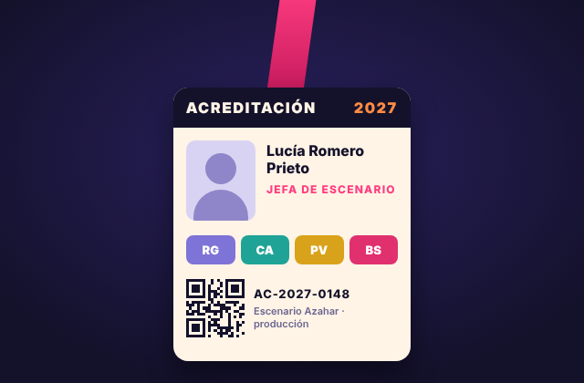 |
| **Actuación** | Concierto de un artista en un escenario, con hora de inicio y de fin, dentro de una edición. | |
| **Aforo** | Número máximo de personas que puede haber a la vez en el recinto o en una zona. Lo fija la autorización del evento. | 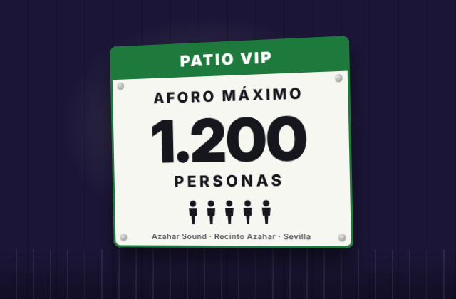 |
| **Autorización de menores** | Documento que firma el adulto responsable para que un menor de 16 años pueda entrar, y en el que se compromete a acompañarlo durante toda la jornada. | 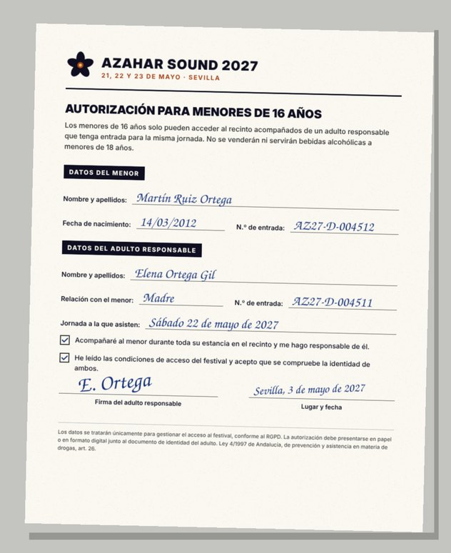 |
| **Backstage** | Zona restringida detrás de los escenarios, con los camerinos y la producción, a la que solo se entra con acreditación. Le da nombre a nuestro sistema. | |
| **Cabeza de cartel** | Cada uno de los artistas principales de una jornada, los que más público atraen. Salen destacados en el cartel. | |
| **Cambio de escenario** | Tiempo entre dos actuaciones del mismo escenario para desmontar el equipo de un artista y montar el del siguiente. En Azahar Sound es de 30 minutos como mínimo. | |
| **Canje** | Cambio de la credencial (la entrada, en papel o en el móvil, o la acreditación) por la pulsera, en las taquillas o en la puerta. Desde ese momento la pulsera queda activa. | |
| **Cartel** | Lista de los artistas de una edición, organizada por jornadas. En inglés, *line-up*. |  |
| **Cashless** | Sistema de pago sin efectivo: todo se paga con la pulsera, a la que antes se le ha cargado saldo. | |
| **Comprador** | Asistente que paga una entrada. Puede comprarla para él o para otra persona, que será su titular. | |
| **Credencial** | Lo que da derecho a entrar en el festival: una entrada, para el público, o una acreditación, para los profesionales. Al canjearla se le asocia una pulsera. | |
| **Devolución de saldo** | Reembolso del saldo que sobra cuando termina el festival. | |
| **Edición** | Cada vez que se celebra el festival, una por año. Por ejemplo, Azahar Sound 2027. | |
| **Entrada de día** | Entrada que solo vale para una jornada concreta. | |
| **Entrada nominativa** | Entrada a nombre de una persona, el titular, que tiene que enseñar su documento para entrar. | 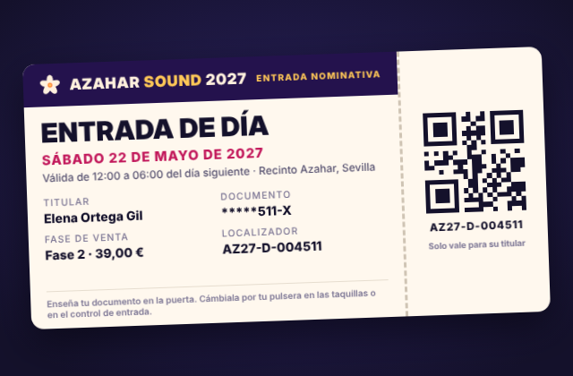 |
| **Escaleta** | Hoja con el orden y el horario de las actuaciones de un escenario en una jornada. | 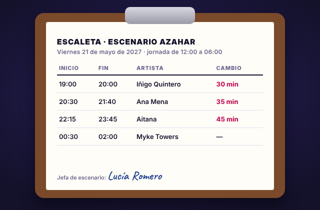 |
| **Escenario** | Sitio donde actúan los artistas. Azahar Sound tiene cuatro: Azahar, Guadalquivir, Carpa Alameda y Patio. | |
| **Fase de venta** | Periodo en el que un tipo de entrada se vende a un precio y con un cupo máximo. Cuando se acaba el cupo o termina el plazo, empieza la fase siguiente, que es más cara. | |
| **Food truck** | Camión de comida que funciona como punto de venta dentro del recinto. | |
| **Incidencia** | Cualquier problema que pasa durante una jornada y que hay que dejar registrado: sanitario, de seguridad o técnico. | |
| **Jornada** | Cada día de festival. Empieza a las 12:00 y termina a las 06:00 del día siguiente, porque los conciertos siguen después de medianoche. | |
| **Profesional** | Persona que trabaja en el festival, ya sea de la promotora o de otra empresa. Entra con una acreditación. | |
| **Promotora** | Empresa que organiza el festival. La de Azahar Sound es nuestro cliente. | |
| **Pulsera NFC** | Pulsera con un chip que se lee acercándola a un lector, sin contacto. Sirve para entrar en las zonas y para pagar. | 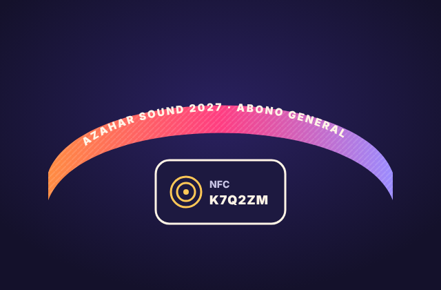 |
| **Punto de venta** | Barra, *food truck* o tienda del recinto donde se paga con la pulsera. | 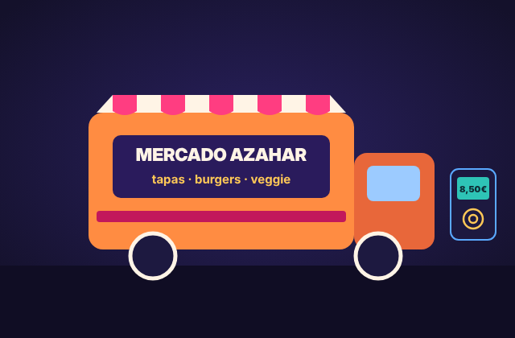 |
| **Recarga** | Ingreso de saldo para pagar con la pulsera, por la web o en un punto de recarga del recinto. | |
| **Reentrada** | Volver a entrar en el recinto o en una zona después de haber salido. | |
| **Reventa** | Venta de una entrada por alguien que no es el festival, normalmente por encima de su precio original. | |
| **Saldo** | Dinero que tiene una credencial para pagar con su pulsera: lo que se ha recargado menos lo que se ha gastado y lo que ya se ha devuelto. | |
| **Titular** | Persona a cuyo nombre está una entrada y que la va a usar para entrar. | |
| **Zona** | Parte del recinto con su propio aforo y control de acceso: el recinto general y, dentro de él, la Carpa Alameda, el Patio VIP y el *backstage*. | |
| **Zona VIP** | Zona con servicios exclusivos a la que solo se entra con abono VIP o con acreditación. En Azahar Sound es el Patio VIP. | |

## 3. Visión general del sistema

### 3.1. Requisitos generales

Hemos agrupado lo que necesita la promotora en cinco requisitos generales. Los hemos escrito como historias de usuario épicas, con el formato de Mike Cohn que vimos en el tema 4 de la asignatura, y cada uno se concreta después en el catálogo de requisitos de la sección 4.

**R.G.01. Gestionar las personas del festival**  
Como director del festival  
quiero registrar a todas las personas que usan el sistema, tanto al público como a los profesionales con su rol  
para saber quién compra, quién trabaja y qué puede hacer cada uno.

**R.G.02. Gestionar la programación del festival**  
Como responsable de programación  
quiero planificar los escenarios, los artistas y las actuaciones de cada edición  
para que el público y el personal puedan consultar un cartel sin conflictos de horario.

**R.G.03. Vender entradas y conceder acreditaciones**  
Como director del festival  
quiero vender entradas nominativas con precio y cupo por tipo de credencial y dar acreditaciones a los profesionales  
para controlar el aforo de cada jornada, frenar la reventa y cumplir las normas sobre menores.

**R.G.04. Gestionar el pago con pulsera y la restauración**  
Como director del festival  
quiero que dentro del recinto todo se pague con la pulsera y que el saldo que sobre se devuelva sin comisiones  
para que las barras vayan más rápido, no se venda alcohol a menores y no tengamos reclamaciones ni multas.

**R.G.05. Controlar el recinto**  
Como director del festival  
quiero controlar las pulseras, los accesos a cada zona y las incidencias  
para no superar nunca un aforo y poder reaccionar a tiempo si pasa algo.

### 3.2. Usuarios del sistema

El sistema lo usan seis tipos de usuario. Todos menos el asistente son profesionales que trabajan en el festival, cada uno con su rol. También hay profesionales sin rol, como los artistas y sus técnicos: se registran para poder darles su acreditación y solo acceden a las consultas de su propia credencial y su saldo.

| Usuario | Qué hace en el sistema |
|:--|:--|
| **Asistente** | Es una persona del público. Compra entradas para ella o para otros, recarga su pulsera, consulta el cartel, sus entradas y su saldo, y pide la devolución del saldo que le sobra. |
| **Director del festival** | Es el responsable de la promotora. Prepara cada edición, con sus aforos y sus tipos de credencial, y sigue las ventas, la ocupación y la recaudación. |
| **Responsable de programación** | Contrata a los artistas y monta el cartel de cada edición. También sigue la escaleta y los cambios de escenario y registra las incidencias técnicas. Reúne las tareas de programación y jefatura de escenario. |
| **Personal de control del recinto** | Lee las pulseras en las puertas, vigila los aforos, consulta los accesos y registra incidencias. Agrupa al personal de accesos, seguridad y puesto sanitario para estas tareas operativas. |
| **Atención al cliente** | Atiende en las taquillas: consulta las credenciales, canjea y repone pulseras, bloquea las que se pierden y tramita las devoluciones de saldo. |
| **Personal de punto de venta** | Lleva una barra, un *food truck* o la tienda: sus productos, sus precios y su *stock*. También cobra los consumos con la pulsera. Reúne las tareas del responsable y del vendedor. |

Una misma persona puede ser asistente y profesional a la vez. Por ejemplo, una persona de punto de venta que trabaja el viernes y se compra una entrada de día para ir el domingo. Cada profesional tiene como máximo un rol operativo; ser titular de una acreditación solo da acceso a las consultas personales, no a las funciones del personal organizador.

## 4. Catálogo de requisitos

### 4.1. Requisitos funcionales

#### R.F.01. Cartel de una jornada

Como asistente  
quiero consultar el cartel de una jornada, con la hora de inicio y de fin de cada actuación, el artista, su género musical, el escenario, la zona donde está y su estado, ordenado por fecha y hora de inicio  
para decidir qué conciertos ver y cómo moverme por el recinto.

#### R.F.02. Escaleta de un escenario

Como responsable de programación  
quiero consultar las actuaciones no canceladas de mi escenario en una jornada, con su hora de inicio y de fin y los minutos que hay hasta la siguiente actuación  
para preparar a tiempo cada cambio de escenario.

#### R.F.03. Mis credenciales

Como asistente o profesional acreditado  
quiero consultar el listado de las credenciales de las que soy comprador o titular, viendo su código, tipo, titular, estado y pulsera actual, si ya se ha canjeado  
para revisar mis compras y conocer los datos de mi propia credencial antes y después del canje.

#### R.F.04. Ventas por tipo de credencial

Como director del festival  
quiero consultar un listado con el número de entradas no anuladas agrupadas por edición y tipo de credencial, mostrando la suma de sus precios pagados  
para analizar las ventas y planificar los precios de la próxima edición.

#### R.F.05. Ocupación prevista de cada jornada

Como director del festival  
quiero consultar el número de titulares con credencial no anulada para cada jornada de una edición, desglosado por público y profesionales  
para prever las necesidades de seguridad, sanitarios y limpieza y comprobar cuánto falta para alcanzar el aforo autorizado.

#### R.F.06. Menores de una jornada y su adulto responsable

Como personal de control del recinto  
quiero consultar, para una jornada, los titulares con credencial no anulada que necesitan adulto responsable por su edad al inicio de la validez de esa credencial, junto con el nombre y teléfono del adulto y si tienen autorización  
para agilizar el control en puerta y poder contactar con el adulto en caso de una incidencia.

#### R.F.07. Mi saldo y mis movimientos

Como asistente o profesional acreditado  
quiero consultar el saldo actual y el saldo disponible de mi credencial y mis recargas y consumos ordenados por fecha y hora, con el producto y el punto de venta de cada consumo, además del estado de mi devolución  
para saber cuánto dinero me queda y en qué me lo he gastado.

#### R.F.08. Ventas de un punto de venta por producto y hora

Como personal de punto de venta  
quiero consultar, para un punto de venta seleccionado y una jornada, las unidades vendidas y el importe de cada producto en cada franja de una hora  
para saber a qué horas se vende más y preparar el personal y el *stock*.

#### R.F.09. Productos que hay que reponer

Como personal de punto de venta  
quiero consultar los productos de un punto de venta seleccionado cuyo *stock* está por debajo del mínimo, con las unidades que se han vendido en la jornada y las que faltan para llegar al mínimo  
para pedir a tiempo la reposición de lo que se está acabando.

#### R.F.10. Saldo sin reclamar

Como director del festival  
quiero consultar las credenciales de una edición, entradas y acreditaciones, que tienen saldo y todavía no han pedido la devolución, con su titular y su saldo  
para saber cuánto dinero está sin reclamar y poder avisar a sus titulares durante la campaña de recordatorio de devoluciones.

#### R.F.11. Personas dentro de cada zona

Como personal de control del recinto  
quiero consultar en tiempo real el número de personas que hay dentro de una zona seleccionada y su aforo permitido en la edición, aplicando en el recinto general el menor entre su aforo físico y el autorizado  
para saber si puedo dejar entrar a más público sin superar el límite permitido.

#### R.F.12. Accesos de una credencial

Como personal de control del recinto  
quiero consultar el historial de accesos de una credencial, con la fecha y hora, la zona y el resultado de cada lectura  
para comprobar por dónde ha pasado su titular y detectar intentos de acceso denegados o lecturas repetidas.

#### R.F.13. Incidencias por zona, tipo y gravedad

Como director del festival  
quiero consultar las incidencias registradas en una jornada agrupadas por zona, tipo (sanitaria, seguridad o técnica) y gravedad (leve, grave o muy grave)  
para evaluar qué áreas del recinto son más conflictivas y dimensionar mejor al personal en la próxima edición.

#### 4.1.1. Requisitos de información

##### R.I.01. Información sobre usuarios

Como director del festival  
quiero disponer de la siguiente información sobre cada usuario del sistema:

- Identificador del usuario.
- Correo electrónico, con el que entra en el sistema. No se puede repetir.
- Contraseña, guardada mediante un hash, nunca en texto legible.
- Nombre y apellidos.
- Documento de identidad (DNI, NIE o pasaporte). No se puede repetir.
- Fecha de nacimiento.
- Teléfono, si quiere darlo; obligatorio si figura como adulto responsable de un menor.
- Fecha de alta en el sistema.
- Si es asistente, profesional o las dos cosas a la vez. Todo usuario es al menos una de ellas.
- Si es profesional, la empresa u organización para la que trabaja y su rol en el sistema, si lo tiene: director del festival, responsable de programación, personal de control del recinto, atención al cliente o personal de punto de venta. Los artistas, sus técnicos y otros profesionales que solo vienen acreditados no tienen rol. El asistente accede a sus propias consultas; un profesional también puede consultar su credencial y su saldo.

para identificar a todas las personas que compran, trabajan o entran en el festival, saber qué puede hacer cada una en el sistema y poder aplicar las normas de edad.

**Relaciones:** Ninguna (entidad raíz independiente). Las entidades que utilizan un usuario indican su referencia en sus propios requisitos.

##### R.I.02. Información sobre ediciones

Como director del festival  
quiero disponer de la siguiente información sobre cada edición del festival:

- Identificador de la edición.
- Nombre, por ejemplo «Azahar Sound 2027».
- Año. No se puede repetir.
- Fecha de inicio y fecha de fin, ambas del año de la edición y con inicio no posterior al fin. Son las fechas de la primera y la última jornada: en 2027, 21/05/2027 y 23/05/2027. El cierre efectivo es el 24/05/2027 a las 06:00.
- Aforo máximo autorizado por jornada, positivo y contando al público y a los profesionales. No puede superar el aforo físico del recinto general.

para organizar cada año por separado y poder comparar unas ediciones con otras.

**Relaciones:** Ninguna (entidad raíz independiente). Las jornadas se calculan a partir de sus fechas; no se guarda una lista de jornadas.

##### R.I.03. Información sobre zonas

Como director del festival  
quiero disponer de la siguiente información sobre cada zona del recinto:

- Identificador de la zona.
- Nombre, que no se puede repetir.
- Tipo: recinto general, pública, VIP o profesional. Hay una sola zona de tipo recinto general; todas las demás están dentro de ella.
- Aforo máximo, mayor que cero, y ubicación dentro del recinto.

para controlar cuánta gente cabe en cada zona y quién puede entrar en ella.

**Relaciones:** Ninguna (entidad raíz independiente). La distribución es fija: un recinto general y zonas interiores, sin más niveles de anidamiento.

##### R.I.04. Información sobre escenarios

Como responsable de programación  
quiero disponer de la siguiente información sobre cada escenario:

- Identificador del escenario.
- Nombre, que no se puede repetir.
- Zona en la que está.
- Profesional responsable, cuando ya se ha asignado, con el rol de responsable de programación.

para saber dónde es cada actuación y quién coordina su escaleta.

**Relaciones:**

- `zonaId` → R.I.03 (Zona): cada escenario pertenece a `1` zona; una zona tiene `0..*` escenarios.
- `responsableId` → R.I.01 (Usuario), opcional: cada escenario tiene `0..1` responsable; un usuario puede coordinar `0..*` escenarios.

##### R.I.05. Información sobre artistas

Como responsable de programación  
quiero disponer de la siguiente información sobre cada artista:

- Identificador del artista.
- Nombre artístico, que no se puede repetir.
- Género musical y país de origen.

para preparar el cartel sin repetir la ficha de un artista cada vez que actúa.

**Relaciones:** Ninguna (entidad raíz independiente). La ficha artística representa un solista o grupo; las personas de su equipo se identifican como usuarios cuando necesitan acreditación.

##### R.I.06. Información sobre actuaciones

Como responsable de programación  
quiero disponer de la siguiente información sobre cada actuación:

- Identificador de la actuación.
- Artista que actúa, escenario y edición.
- Fecha y hora de inicio y de fin.
- Si es cabeza de cartel.
- Estado: programada, realizada o cancelada.

para preparar el cartel y organizar el trabajo de cada escenario, respetando R.N.01.

**Relaciones:**

- `artistaId` → R.I.05 (Artista): cada actuación tiene `1` artista; un artista tiene `0..*` actuaciones.
- `escenarioId` → R.I.04 (Escenario): cada actuación se celebra en `1` escenario; un escenario acoge `0..*` actuaciones.
- `edicionId` → R.I.02 (Edición): cada actuación pertenece a `1` edición; una edición programa `0..*` actuaciones.

##### R.I.07. Información sobre tipos de credencial

Como director del festival  
quiero disponer de la siguiente información sobre cada tipo de credencial:

- Identificador del tipo y edición a la que pertenece.
- Nombre, único dentro de su edición: Abono General, Abono VIP, Entrada de viernes, Acreditación de Staff, etc.
- Destinatario: público o profesional.
- Validez: una fecha de jornada de su edición, o sin fecha si cubre todas sus jornadas. Sirve tanto para entradas como para acreditaciones.
- Perfil de acceso: general, VIP, operativo o completo. El público solo puede tener perfil general o VIP; los profesionales pueden tener cualquiera de los cuatro según su trabajo. Los permisos se detallan en R.N.10 y no dependen del rol de usuario.
- Precio final actual, incluidos los gastos, y cupo máximo de credenciales no anuladas de este tipo, según R.N.02. No hay fases de venta.

para configurar las entradas y acreditaciones y definir sus permisos de acceso al recinto.

**Relaciones:** `edicionId` → R.I.02 (Edición): cada tipo pertenece a `1` edición; una edición dispone de `0..*` tipos. El perfil de acceso es un valor enumerado, no una FK ni una lista de zonas.

##### R.I.08. Información sobre credenciales

Como atención al cliente  
quiero disponer de la siguiente información sobre cada credencial, sea una entrada o una acreditación:

- Código alfanumérico único de la credencial, que sirve como identificador.
- Tipo de credencial. Su edición, destinatario, validez y perfil se obtienen del tipo, sin volver a guardarlos aquí.
- Usuario titular que la usará. Si es de público, debe ser asistente; si es de profesionales, debe ser profesional.
- Usuario que realizó la compra, que debe ser asistente; obligatorio para entradas de público y sin valor para acreditaciones.
- Fecha y hora de emisión y precio final pagado, que no cambia después. Las acreditaciones son gratuitas.
- Estado: emitida, canjeada o anulada. «Emitida» incluye la entrada comprada y la acreditación concedida; «anulada» incluye la entrada devuelta y la acreditación revocada. No se reactiva una credencial anulada.
- Fecha y hora del primer canje, cuando se haya realizado. Se conserva aunque después se anule la credencial.
- Para menores de 16 años: adulto responsable y enlace al documento de autorización, inicialmente opcionales y obligatorios antes del canje en los casos de R.N.05.
- Código NFC de la pulsera actual, único cuando existe; estado de esa pulsera (activa o bloqueada), fecha y hora de asignación y, si está bloqueada, fecha y hora de bloqueo. Antes del primer canje no tienen valor. La reposición sustituye estos datos, según R.N.11.
- Datos de la devolución de saldo: fecha y hora de solicitud, importe solicitado, profesional de atención al cliente que la tramita y fecha y hora de pago, esta última opcional mientras esté pendiente. Antes de solicitarla, todos están sin valor. Su estado se deduce: sin solicitar, solicitada o pagada (R.N.09).
- Saldo actual, calculado como recargas menos consumos menos el importe de la devolución si ya está pagada. El saldo disponible es cero mientras hay una devolución solicitada; en otro caso coincide con el actual. No se almacena un segundo saldo en la pulsera.

para gestionar la asistencia, resolver problemas de compra, realizar el canje y devolver el saldo sobrante sin perder los movimientos al reponer una pulsera.

**Relaciones:**

- `tipoCredencialId` → R.I.07 (Tipo de credencial): cada credencial tiene `1` tipo; un tipo tiene `0..*` credenciales.
- `titularId` → R.I.01 (Usuario): cada credencial tiene `1` titular; un usuario puede ser titular de `0..*` credenciales, con la restricción de R.N.04.
- `compradorId` → R.I.01 (Usuario), opcional en el conjunto de credenciales: cada credencial tiene `0..1` comprador; un usuario compra `0..*` credenciales, con el límite de R.N.03.
- `adultoResponsableId` → R.I.01 (Usuario), opcional hasta que lo exija R.N.05: cada credencial tiene `0..1` adulto responsable; un usuario puede acompañar a titulares de `0..*` credenciales.
- `tramitadorDevolucionId` → R.I.01 (Usuario), opcional hasta que se solicite la devolución: cada credencial tiene `0..1` tramitador; un profesional tramita `0..*` devoluciones integradas en credenciales.

##### R.I.09. Información sobre puntos de venta

Como director del festival  
quiero disponer de la siguiente información sobre cada punto de venta:

- Identificador del punto de venta.
- Edición en la que abre, que no se cambia una vez que el punto de venta tiene productos.
- Nombre, que no se puede repetir dentro de la edición.
- Tipo: barra, *food truck* o tienda.
- Zona en la que está y responsable, que tiene que ser un profesional con el rol de personal de punto de venta.

para saber dónde se vende y quién se encarga de cada barra, *food truck* y tienda.

**Relaciones:**

- `edicionId` → R.I.02 (Edición): cada punto de venta pertenece a `1` edición; una edición tiene `0..*` puntos de venta.
- `zonaId` → R.I.03 (Zona): cada punto de venta está en `1` zona; una zona alberga `0..*` puntos de venta.
- `responsableId` → R.I.01 (Usuario): cada punto de venta tiene `1` responsable; un usuario puede ser responsable de `0..*` puntos de venta.

##### R.I.10. Información sobre productos

Como personal de punto de venta  
quiero disponer de la siguiente información sobre cada producto de mi punto de venta:

- Identificador del producto y punto de venta en el que se vende. No se cambia de punto una vez que tiene consumos registrados.
- Nombre, que no se puede repetir dentro de su punto de venta.
- Categoría: bebida, comida o merchandising.
- Precio actual, mayor que cero.
- Si lleva alcohol.
- *Stock* disponible y *stock* mínimo, ambos enteros no negativos.

para saber qué se vende, a qué precio y cuántas unidades quedan.

**Relaciones:** `puntoVentaId` → R.I.09 (Punto de venta): cada producto pertenece a `1` punto de venta; un punto de venta ofrece `0..*` productos. «Cerveza» en dos barras son dos productos de venta distintos, cada uno con su precio y existencias; no hay un catálogo global ni una relación muchos a muchos.

##### R.I.11. Información sobre movimientos de saldo

Como director del festival  
quiero disponer de la siguiente información sobre cada movimiento del saldo de una credencial:

- Identificador del movimiento, utilizado también para evitar registrar dos veces una misma operación si el lector la reenvía.
- Credencial a la que pertenece y fecha y hora de la operación.
- Tipo de movimiento: recarga o consumo.
- Si es una recarga: importe y canal (web o punto de recarga). Se recarga a la credencial y no a la pulsera, porque se puede recargar por la web antes de tenerla.
- Si es un consumo: producto, cantidad entera positiva, precio unitario en el momento de la venta y vendedor que cobra, con rol de personal de punto de venta. El precio histórico no cambia aunque después cambie el precio del producto. El importe se calcula multiplicando cantidad por precio unitario.

para saber cuánto dinero se ha cargado, qué se ha comprado, a qué precio y quién lo ha cobrado, y poder calcular el saldo. Los campos exclusivos de recarga quedan sin valor en un consumo y viceversa. Cada consumo corresponde a un solo producto; una compra de varios productos genera varios consumos. Los movimientos confirmados no se modifican ni se borran en esta versión.

**Relaciones:**

- `credencialId` → R.I.08 (Credencial): cada movimiento pertenece a `1` credencial; una credencial tiene `0..*` movimientos.
- `productoId` → R.I.10 (Producto), obligatorio solo para consumos: cada movimiento tiene `0..1` producto; un producto figura en `0..*` consumos.
- `vendedorId` → R.I.01 (Usuario), obligatorio solo para consumos: cada movimiento tiene `0..1` vendedor; un usuario cobra `0..*` consumos. El punto de venta se obtiene del producto. El código NFC se usa para validar el cobro, pero no se guarda en el movimiento: el histórico pertenece a la credencial.

##### R.I.12. Información sobre accesos

Como personal de control del recinto  
quiero disponer de la siguiente información sobre cada lectura en un punto de control:

- Identificador de la lectura, único incluso si se reenvía por un fallo de conexión.
- Credencial identificada a partir del código NFC leído, si se reconoce. El código se usa en la comprobación, pero no se guarda en el acceso. En una salida asistida sin pulsera, el personal debe identificar directamente la credencial.
- Zona a la que se intenta acceder o de la que se sale.
- Fecha y hora exacta, con segundos, de la lectura.
- Tipo de movimiento: entrada o salida.
- Usuario que ha validado la lectura, con rol de personal de control del recinto.
- Resultado: permitido o denegado, con motivo obligatorio si se deniega. Una lectura de un código desconocido queda denegada y sin credencial asociada.

para mantener el registro de quién está dentro de cada zona y quién lo ha dejado pasar. Las lecturas se registran en orden de llegada y no se modifican ni se borran; solo las permitidas cambian la ocupación (R.N.10).

**Relaciones:**

- `credencialId` → R.I.08 (Credencial), opcional para códigos desconocidos: cada lectura identifica `0..1` credencial; una credencial tiene `0..*` lecturas. La edición de una lectura identificada se obtiene de la credencial.
- `zonaId` → R.I.03 (Zona): cada lectura afecta a `1` zona; una zona tiene `0..*` lecturas.
- `validadorId` → R.I.01 (Usuario): cada lectura tiene `1` validador; un usuario valida `0..*` lecturas. La relación con la credencial se conserva aunque después se reponga la pulsera.

##### R.I.13. Información sobre incidencias

Como personal de control del recinto  
quiero disponer de la siguiente información sobre cada incidencia ocurrida:

- Identificador de la incidencia y edición.
- Fecha y hora exacta, dentro de una jornada de esa edición.
- Zona donde se ha producido. Si sucede en un escenario, se selecciona la zona del escenario y se menciona su nombre en la descripción.
- Tipo de incidencia: sanitaria, seguridad o técnica.
- Gravedad: leve, grave o muy grave.
- Descripción de lo ocurrido, sin datos clínicos ni identidad de pacientes.
- Profesional que la ha registrado, con rol de personal de control del recinto o responsable de programación.

para tener un registro centralizado de los problemas del evento y evitar que la información se pierda en grupos de WhatsApp o partes de papel.

**Relaciones:**

- `edicionId` → R.I.02 (Edición): cada incidencia pertenece a `1` edición; una edición registra `0..*` incidencias.
- `zonaId` → R.I.03 (Zona): cada incidencia ocurre en `1` zona; una zona tiene `0..*` incidencias.
- `registradorId` → R.I.01 (Usuario): cada incidencia tiene `1` autor; un usuario registra `0..*` incidencias.

#### 4.1.2. Reglas de negocio

##### R.N.01. Programación válida y sin solapes

Dos actuaciones del mismo escenario no se pueden solapar, y entre el final de una y el principio de la siguiente tiene que haber al menos 30 minutos, que es lo que se tarda en desmontar el equipo de un artista y montar el del siguiente. Las actuaciones canceladas no cuentan. Un artista tampoco puede actuar en dos escenarios a la vez.

Una actuación tiene que terminar después de empezar y durar entre 30 minutos y 3 horas. Además, tiene que caer entera dentro de una jornada de su edición, es decir, entre las 12:00 de uno de sus días y las 06:00 del día siguiente. Entre las 06:00 y las 12:00 no hay actuaciones. Estas condiciones también se comprueban al modificar o reactivar una actuación (R.I.02, R.I.04, R.I.05 y R.I.06).

**Prueba de aceptación**

- Si el Escenario Guadalquivir solo tiene el viernes 21 una actuación, de 20:30 a 21:40, se programa otra de 22:10 a 23:10, justo 30 minutos después, y se registra sin errores.
- En esa misma situación, se intenta programar otra de 21:50 a 22:50 y se recibe un mensaje de error, porque solo quedarían 10 minutos para el cambio.
- El viernes 21, en el Escenario Patio, que esa noche no tiene actuaciones, se programa a otro artista de 21:00 a 22:00 y se registra sin errores aunque coincida con la del Guadalquivir. Si fuera el mismo artista, se rechazaría.
- Se programa una actuación de 01:00 a 02:30 de la madrugada del domingo y se registra sin errores, porque pertenece a la jornada del sábado.
- En un escenario libre se admiten por separado actuaciones del 22/05/2027 de 20:00 a 20:30 y de 20:00 a 23:00. Se rechazan las de 20:00 a 20:29 y de 20:00 a 23:01 por quedar fuera de los límites de duración.
- Se intenta programar una actuación el sábado 22 de 05:00 a 06:30, que se sale de la jornada del viernes, y se recibe un mensaje de error.

##### R.N.02. Precio y cupo del tipo de credencial

Cada tipo de credencial tiene un precio final y un cupo máximo de credenciales no anuladas. El precio es mayor que cero para el público y cero para las acreditaciones profesionales; el cupo es un entero positivo. Al agotarse el cupo no se permiten nuevas emisiones.

El precio pagado por una entrada queda registrado de forma inmutable; si el precio sube posteriormente, el histórico de la entrada ya vendida no se altera. El cupo no puede reducirse por debajo de las credenciales no anuladas que ya existen. El tipo de una credencial emitida y la edición, destinatario, validez y perfil de un tipo ya utilizado no se cambian (R.I.07 y R.I.08).

**Prueba de aceptación**

- Se configura «Abono General 2027» con cupo de 1.000 abonos. Se permite vender el número 1.000, pero se rechaza el siguiente. Al anular uno, queda una plaza disponible, siempre que se cumplan R.N.03 y R.N.04.
- Se consulta una entrada vendida a 40 € cuando el precio actual del tipo es 70 €, y la entrada sigue mostrando 40 € como precio pagado. Las nuevas entradas se emiten por 70 €.
- Se admite una acreditación profesional gratuita con cupo 1. Se rechazan una entrada de público de 0 €, una acreditación de 1 € y los cupos 0 o 1,5.
- Con 800 credenciales no anuladas se admite fijar el cupo en 800, pero no en 799. Tampoco se puede convertir un tipo «Entrada de viernes» en «Entrada de sábado» si ya tiene credenciales emitidas.

##### R.N.03. Máximo cuatro entradas por comprador y edición

Un mismo usuario en su rol de comprador no puede tener más de 4 entradas no anuladas para la misma edición del festival, sumando todos los tipos de entrada adquiridos. Esta restricción es por comprador, independientemente de quiénes sean los titulares de esas entradas. Las acreditaciones profesionales no cuentan y una entrada anulada libera una plaza de compra. El comprador original no se cambia después de emitir la entrada (R.I.01, R.I.07 y R.I.08).

**Prueba de aceptación**

- Un usuario compra 4 abonos generales para 2027 poniéndose a sí mismo y a 3 amigos como titulares, y la compra se completa sin errores.
- Ese mismo usuario intenta comprar 1 entrada de día extra para 2027 y el sistema bloquea la compra mostrando un mensaje de error.
- Ese usuario intenta comprar entradas para la edición de 2028, y el sistema se lo permite porque la restricción es por edición.

##### R.N.04. Aforo máximo de cada jornada

El sistema bloqueará cualquier venta de entradas o emisión de acreditaciones si la suma total de personas con derecho a acceder en una jornada supera el aforo máximo autorizado para esa jornada (R.I.02). Para este cálculo cuentan tanto las entradas de día de esa jornada, como los abonos generales, abonos VIP y las acreditaciones profesionales no anuladas.

Un titular no puede tener dos credenciales no anuladas para una misma jornada de la misma edición, para no reservarle dos plazas. Tampoco se puede reducir el aforo autorizado por debajo de las plazas ya reservadas o de las personas que siguen dentro del recinto (R.I.07 y R.I.08).

**Prueba de aceptación**

- Si el aforo máximo de la jornada del viernes es 15.000 personas y hay 14.999 credenciales válidas emitidas para ese día, se vende una entrada de viernes y se procesa sin errores.
- Con 15.000 credenciales válidas para el viernes, se intenta comprar un abono general (que incluye el viernes) o emitir una acreditación más, y el sistema lo impide mostrando un mensaje de error de aforo completo.
- Se devuelve una entrada de viernes, liberando espacio, y el sistema permite una nueva venta para esa jornada.
- Elena ya tiene abono general de 2027 y no puede recibir otra entrada para el viernes. Un profesional sí puede tener una acreditación solo para el viernes y una entrada para el domingo.

##### R.N.05. Menores de 16 años con adulto responsable

Si el usuario asignado como titular de una credencial tiene menos de 16 años cumplidos el día en que comienza su validez, el sistema exigirá registrar un adulto responsable de al menos 18 años en esa fecha, con documento de identidad y teléfono, y subir un documento de autorización firmado antes de permitir el canje por la pulsera de acceso.

El adulto debe tener una credencial que cubra las mismas jornadas. En un abono se toma la edad del primer día y se mantiene el acompañamiento durante todo el festival. En cada entrada o reentrada, el personal comprueba que el adulto lo acompaña y registra primero su entrada. Si cambia el responsable, se comprueban de nuevo sus datos (R.I.01, R.I.08 y R.I.12).

**Prueba de aceptación**

- Un titular de 15 años se presenta al canje sin un adulto responsable registrado en su entrada, y el sistema bloquea el canje mostrando una alerta.
- Se añade el DNI y teléfono de un usuario de 19 años con entrada para la misma jornada y se adjunta la autorización PDF, y el sistema permite el canje. Si falta la autorización, se rechaza.
- Para una entrada del 21/05/2027, quien nació el 21/05/2011 ya tiene 16 años y no necesita autorización; quien nació el 22/05/2011 sí la necesita. Un adulto nacido el 21/05/2009 puede ser responsable ese día; uno nacido el 22/05/2009 todavía no.
- Martín tiene abono del 21 al 23/05/2027 y Lucía solo tiene entrada del viernes: no sirve como responsable de todo el abono. Con credencial para los tres días y autorización, se permite el canje; en puerta se deniega la entrada de Martín si Lucía no lo acompaña.

##### R.N.06. Saldo nunca negativo y límites de recarga

El saldo de una credencial no puede quedar nunca por debajo de cero: se rechaza un consumo si su importe, que es la cantidad por el precio unitario, supera el saldo disponible de la credencial a la que pertenece la pulsera. El saldo es lo que se ha recargado menos lo que se ha consumido y menos lo que ya se ha devuelto. Además, cada recarga tiene que ser de 5 € como mínimo y de 200 € como máximo.

Las recargas se hacen a credenciales no anuladas antes del cierre de la edición. Para consumir se necesita una credencial canjeada, su pulsera actual activa, una jornada cubierta y un producto de la misma edición. Se conserva el precio unitario del momento del cobro. No se admiten nuevos movimientos tras el cierre ni después de solicitar la devolución (R.I.08–R.I.11).

**Prueba de aceptación**

- Si una entrada tiene un saldo de 10 €, se cobran 2 bocadillos de 5 € y el consumo se registra sin errores, porque el saldo queda en 0 €.
- En esa misma situación, con un saldo de 10 €, se intenta cobrar 3 bocadillos de 5 € (15 €) y se recibe un mensaje de error.
- Se registra una recarga de 5 € y otra de 200 €, y las dos se registran sin errores.
- Se intentan registrar recargas de 4,99 € y de 200,01 €, y las dos se rechazan.
- Con saldo y stock suficientes, se rechaza un consumo con pulsera bloqueada o con entrada de viernes el sábado 22/05/2027 a las 18:00. Desde el cierre del 24/05/2027 a las 06:00 tampoco se admiten recargas ni consumos.

##### R.N.07. Prohibida la venta de alcohol a menores

No se puede vender un producto con alcohol a una pulsera cuyo titular tenga menos de 18 años en el momento de la venta. La edad se calcula con la fecha de nacimiento del titular y la fecha y hora local del consumo. Los productos sin alcohol se pueden vender a cualquier titular si cumple las demás reglas de cobro.

**Prueba de aceptación**

- Martín Ruiz Ortega, nacido el 14/03/2012, tiene 15 años en mayo de 2027: se intenta cobrarle una cerveza con saldo suficiente a su pulsera el sábado 22 de mayo a las 20:00 y se recibe un mensaje de error.
- Ese mismo titular, con saldo suficiente, compra un refresco sin alcohol el mismo día y el consumo se registra sin errores.
- Si el titular de un abono nació el 22/05/2009 y su pulsera tiene saldo suficiente, se intenta cobrarle una cerveza el viernes 21 de mayo de 2027 a las 23:59:59 y se recibe un mensaje de error, porque todavía tiene 17 años.
- En esa misma situación, se le cobra una cerveza el sábado 22 de mayo de 2027 a las 00:00 y se registra sin errores, porque ya ha cumplido 18 años.

##### R.N.08. Control de stock

No se puede vender más cantidad de un producto que su *stock* disponible. Cada consumo descuenta su cantidad del *stock* del producto. La cantidad debe ser un entero positivo. Si el cobro se rechaza, no se descuenta stock ni saldo. Las existencias nunca pueden quedar por debajo de cero (R.I.10 y R.I.11).

**Prueba de aceptación**

- Si el agua de la «Barra Azahar» tiene 100 unidades de *stock* y se cobran 2 con una pulsera con saldo suficiente, el consumo se registra sin errores y el *stock* pasa a 98.
- Si un producto tiene 5 unidades de *stock* y se cobran las 5 con una pulsera con saldo suficiente, el consumo se registra sin errores y el *stock* queda en 0.
- Si un producto tiene 5 unidades de *stock*, se intenta cobrar 6 con una pulsera con saldo suficiente y se recibe un mensaje de error. El *stock* sigue en 5.
- Con stock de 10 unidades se rechazan cantidades 0, −1 y 1,5. Si se intenta comprar un agua de 2 € con saldo de 1 €, también se rechaza y el stock sigue en 10.

##### R.N.09. Devolución del saldo sin comisión

La devolución del saldo sobrante se puede pedir desde que termina la última jornada de la edición. En 2027 eso es desde el lunes 24 de mayo a las 06:00. Cada credencial solo puede pedir una devolución, sin comisión y por el saldo completo positivo que tenga en ese momento, aunque sea menor de 2 € o esté anulada. La campaña de recordatorio no limita el plazo para reclamarlo.

La solicitud se guarda en la credencial, su importe no se modifica y deja el saldo disponible a cero. El saldo actual se descuenta cuando se confirma el pago, una sola vez y con fecha no anterior a la solicitud (R.I.08 y R.I.11).

**Prueba de aceptación**

- Si una entrada tiene un saldo de 11,50 €, se solicita su devolución el lunes 24 de mayo de 2027 a las 06:00, justo cuando termina la última jornada, y se registra sin errores por 11,50 €, sin ninguna comisión.
- Si una entrada tiene un saldo de 1,20 €, se solicita su devolución el martes 1 de junio de 2027 y se registra sin errores por 1,20 €, aunque sea menor de 2 €.
- Si una entrada tiene un saldo de 11,50 €, se intenta solicitar su devolución el lunes 24 de mayo de 2027 a las 05:59, cuando todavía no ha terminado la última jornada, y se recibe un mensaje de error.
- Si una entrada ya tiene una devolución solicitada el martes 25 de mayo de 2027, se intenta solicitar otra el miércoles 26 de mayo y se recibe un mensaje de error, porque solo se puede pedir una vez por credencial.
- Si una entrada tiene un saldo de 11,50 € y no lo ha solicitado antes, se admite pedir su devolución el 01/07/2027. Se rechaza pedir solo 10 € o solicitar una devolución con saldo cero.
- Una solicitud de 11,50 € del 25/05/2027 mantiene el saldo actual en 11,50 € y el disponible en cero. Al confirmar el pago el 26/05/2027, el saldo actual queda a cero. Se rechaza registrar otro pago o fecharlo antes de la solicitud.

##### R.N.10. Acceso permitido y aforo de cada zona

Una pulsera solo dará acceso a una zona si su credencial asociada (entrada o acreditación) es válida para la jornada actual y tiene los permisos necesarios para ese tipo de zona. Debe ser la pulsera actual activa de una credencial canjeada. Las entradas se permiten desde las 12:00 hasta antes de las 06:00 del día siguiente, según el perfil del tipo de credencial (R.I.07 y R.I.08).

| Perfil de acceso | Recinto general | Zona pública (Carpa) | Zona VIP (Patio) | Zona profesional (Backstage) |
|:--|:-:|:-:|:-:|:-:|
| General | Sí | Sí | No | No |
| VIP | Sí | Sí | Sí | No |
| Operativo | Sí | Sí | No | Sí |
| Completo | Sí | Sí | Sí | Sí |

El sistema bloqueará cualquier nuevo registro de entrada en una zona si su ocupación actual es igual o superior al aforo máximo definido para dicha zona (R.I.03). Se calcula con entradas permitidas menos salidas permitidas, sin reiniciar el recuento a medianoche; en el recinto general también se respeta el aforo autorizado de la edición. No se puede reducir el aforo por debajo de la ocupación.

Las entradas y salidas de cada zona deben alternarse, sin duplicar la presencia de un titular. Para acceder a una zona interior hay que estar dentro del recinto general. Al cambiar de zona o abandonar el recinto se registra también la salida de la zona interior anterior. Las salidas se permiten incluso con pulsera bloqueada o fuera de horario, con ayuda del personal. La reentrada no tiene recargo y cumple las mismas condiciones que la primera entrada, incluida R.N.05 para menores (R.I.12).

**Prueba de aceptación**

- Un asistente con entrada general intenta entrar en el «Patio VIP», el sistema deniega el acceso y marca una luz roja.
- Un asistente con abono VIP intenta entrar en el «Patio VIP», el sistema lo permite y marca luz verde.
- Un asistente con entrada de día para el viernes intenta entrar al recinto el sábado a las 18:00, el sistema deniega el acceso.
- La «Carpa Alameda» tiene un aforo de 2.500 personas. Hay 2.499 dentro. Se lee una pulsera válida y se permite el acceso.
- A continuación, con 2.500 personas dentro, se lee otra pulsera válida. El sistema deniega el acceso por aforo completo.
- Alguien sale de la Carpa Alameda, la ocupación baja a 2.499. Se vuelve a leer la pulsera que fue denegada antes y ahora el sistema permite el acceso.
- Elena consta dentro del recinto y pierde su pulsera el 21/05/2027 a las 23:00. El personal la bloquea y registra su salida: la ocupación baja en uno. Reentrar con esa pulsera se deniega y el intento queda registrado.

##### R.N.11. Una sola pulsera activa por credencial

Una credencial (entrada o acreditación) solo puede tener asociada una única pulsera en estado «activa». Si se le asocia una nueva pulsera por pérdida, rotura o robo, la anterior deja de servir. El saldo y los accesos permanecen asociados a la misma credencial.

En el canje se comprueba el documento del titular y, si corresponde, R.N.05. La credencial pasa de emitida a canjeada y se le asigna una pulsera cuyo código no puede estar asignado a otra credencial. No se cambia el titular después del primer canje ni de registrar movimientos de saldo. Solo se repone la pulsera de una credencial canjeada. Anular una credencial bloquea su pulsera y no permite reactivarla, pero conserva el saldo para su devolución (R.I.08, R.I.11 y R.I.12).

**Prueba de aceptación**

- Un titular tiene la pulsera A activa con 15 € de saldo y consta dentro de la Carpa. Acude a atención al cliente porque la ha roto. Se verifica su identidad y se asocia una pulsera nueva B a su entrada: A deja de servir, B queda activa y se mantienen los 15 € y la presencia en la Carpa.
- Alguien encuentra la pulsera A rota e intenta pagar una cerveza en una barra. El lector rechaza la operación porque ya no es la pulsera actual.
- Se intenta asignar la pulsera B a otra credencial y se rechaza, tanto si B está activa como si está bloqueada.
- Una credencial emitida, sin canje ni movimientos, puede cambiar de titular si cumple R.N.04 y R.N.05. Después de recargar 5 € o de canjearla, se rechaza el cambio. Si se anula, tampoco se permite otro canje ni reponer su pulsera, pero conserva el saldo para su devolución.

### 4.2. Mapa de historias de usuario (opcional)

Las épicas se sitúan en la cabecera y debajo aparecen únicamente los requisitos funcionales que las concretan, como historias de consulta. Dentro de cada columna se colocan primero las consultas básicas y después las de seguimiento. Cada RF aparece una vez, bajo la épica con la que más se relaciona.

| R.G.01. Gestionar las personas del festival | R.G.02. Gestionar la programación del festival | R.G.03. Vender entradas y conceder acreditaciones | R.G.04. Gestionar el pago con pulsera y la restauración | R.G.05. Controlar el recinto |
|:--|:--|:--|:--|:--|
| R.F.06. Menores de una jornada y su adulto responsable | R.F.01. Cartel de una jornada | R.F.03. Mis credenciales | R.F.07. Mi saldo y mis movimientos | R.F.11. Personas dentro de cada zona |
| | R.F.02. Escaleta de un escenario | R.F.04. Ventas por tipo de credencial | R.F.09. Productos que hay que reponer | R.F.12. Accesos de una credencial |
| | | R.F.05. Ocupación prevista de cada jornada | R.F.08. Ventas de un punto de venta por producto y hora | R.F.13. Incidencias por zona, tipo y gravedad |
| | | | R.F.10. Saldo sin reclamar | |

### 4.3. Requisitos no funcionales (opcional)

**R.N.F. 01. Protección de los datos personales**  
Como director del festival  
quiero que los datos personales, sobre todo los de los menores, los documentos de identidad y las incidencias sanitarias, solo los puedan ver los profesionales que los necesitan para su trabajo  
para cumplir el Reglamento General de Protección de Datos.

**R.N.F. 02. Acceso según el rol**  
Como director del festival  
quiero que cada usuario entre con su correo y su contraseña y solo pueda hacer lo que le permite su tipo de usuario  
para evitar cambios no autorizados en las entradas, los saldos o los accesos.

**R.N.F. 03. Respuesta rápida en accesos y cobros**  
Como director del festival  
quiero que, al leer una pulsera en una puerta o en una barra, la respuesta tarde menos de un segundo, aunque haya 15.000 personas en el recinto  
para que no se formen colas.

**R.N.F. 04. Disponibilidad durante las jornadas**  
Como director del festival  
quiero que el sistema funcione sin cortes durante las jornadas, de 12:00 a 06:00  
para que los accesos y los pagos no se paren nunca.

**R.N.F. 05. Operaciones completas o anuladas**  
Como director del festival  
quiero que cada cobro, recarga, devolución, emisión de credencial o entrada a una zona se complete del todo o no se haga, aunque falle algo a mitad o lleguen dos operaciones a la vez  
para que no se descuadren el saldo, el stock, los cupos ni los aforos.

**R.N.F. 06. Base de datos MariaDB**  
Como director del festival  
quiero que la base de datos funcione en MariaDB  
para usar software libre y no tener que pagar licencias.

**R.N.F. 07. Consulta desde el móvil**  
Como asistente  
quiero consultar el cartel, mis entradas y mi saldo desde el móvil  
para no depender del papel ni tener que ir a un punto de información.

**R.N.F. 08. Copias de seguridad**  
Como director del festival  
quiero que se haga una copia de seguridad completa cada día y una incremental cada hora durante las jornadas  
para no perder ventas ni accesos si falla el servidor.

-- fin entregable 1 --

## 5. Modelo conceptual

### 5.1. Diagramas de clases UML

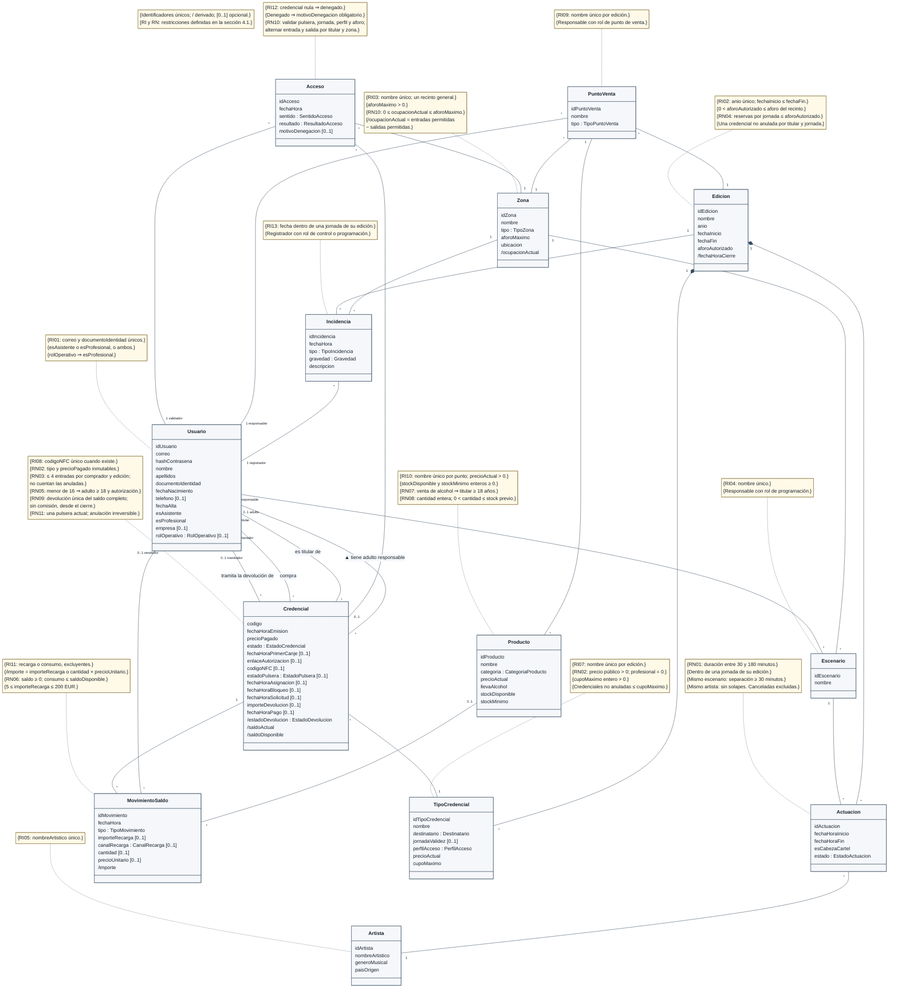

### 5.2. Escenarios de prueba
### RN06: Gestión de saldo y recargas en pulsera

#### Escenario Válido: Recarga exitosa y acumulación de saldo
* **Identificador:** RN06-Valido
* **Descripción:** Un asistente con una credencial canjeada y pulsera activa realiza dos recargas acumulando un saldo total disponible de 205,00 €.
* **Diagrama de Objetos:**
  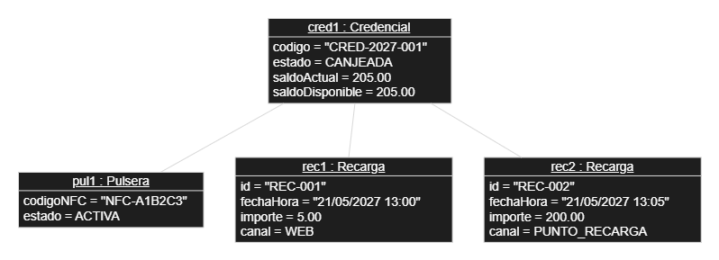

#### Escenario de Rechazo: Saldo insuficiente en cobro
* **Identificador:** RN06-Rechazo
* **Descripción:** Se intenta realizar una consumición de 3 bocadillos (15,00 €) disponiendo únicamente de 10,00 € de saldo. Operación rechazada.
* **Diagrama de Objetos:**
  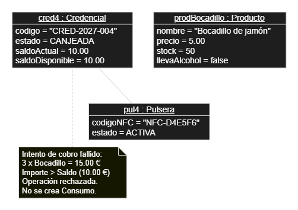

---

### RN07: Restricción de venta de alcohol a menores

#### Escenario de Rechazo: Intento de compra por menor de edad
* **Identificador:** RN07-Rechazo
* **Descripción:** Un asistente menor de edad (16 años) intenta adquirir una consumición con contenido alcohólico. El sistema bloquea automáticamente la venta.
* **Diagrama de Objetos:**
  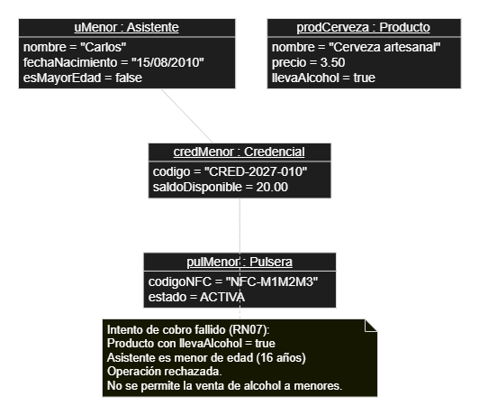

#### Escenario Válido: Compra de alcohol por mayor de edad
* **Identificador:** RN07-Valido
* **Descripción:** Un asistente mayor de edad (27 años) adquiere una consumición alcohólica teniendo saldo suficiente.
* **Diagrama de Objetos:**
  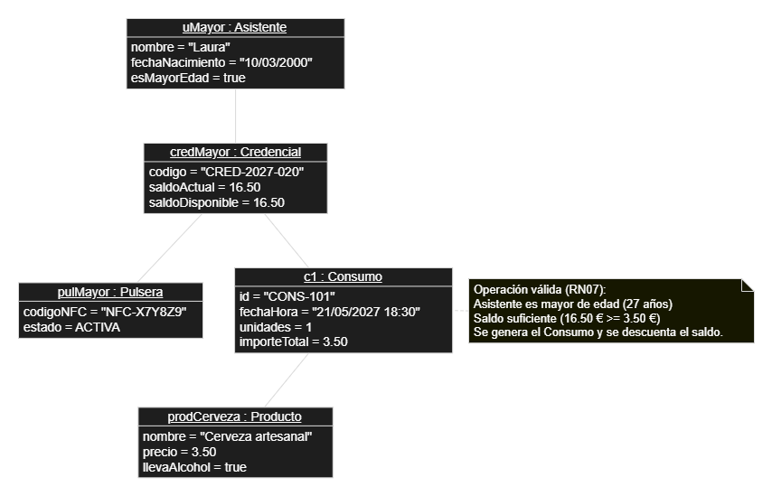

---

### RN08: Control de existencias (Stock de productos)

#### Escenario de Rechazo: Stock insuficiente
* **Identificador:** RN08-Rechazo
* **Descripción:** Se solicita la compra de 2 unidades de un producto del que solo queda 1 unidad en stock.
* **Diagrama de Objetos:**
  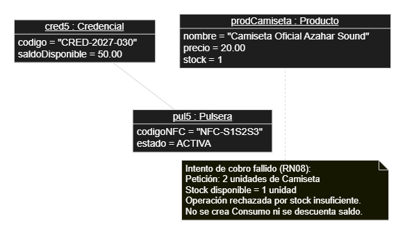

#### Escenario Válido: Venta y decremento de stock
* **Identificador:** RN08-Valido
* **Descripción:** Compra exitosa de 2 camisetas con stock disponible previo de 10 unidades. Se reduce el stock a 8 y se crea el consumo correspondiente.
* **Diagrama de Objetos:**
  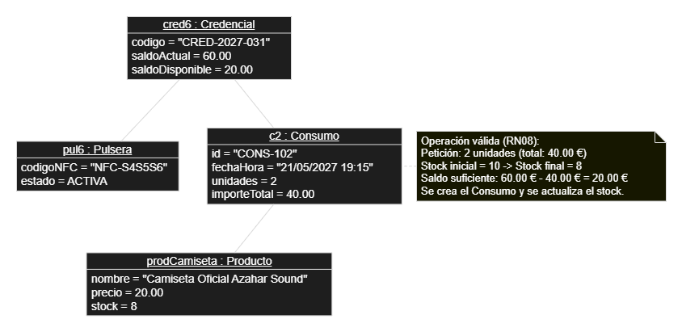

---

### RN09: Devolución de saldo restante

#### Escenario Válido: Reintegro dentro de plazo
* **Identificador:** RN09-Valido
* **Descripción:** Tras la finalización del festival y dentro del plazo establecido, se solicita la devolución de 25,50 € restantes en la pulsera.
* **Diagrama de Objetos:**
  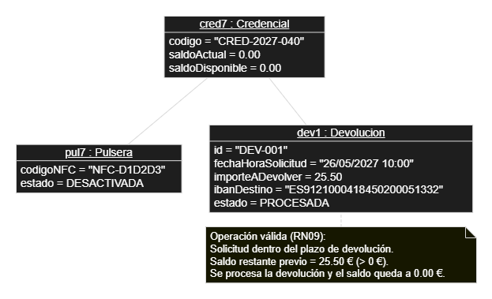

#### Escenario de Rechazo: Solicitud improcedente
* **Identificador:** RN09-Rechazo
* **Descripción:** Intento de tramitar devolución cuando el saldo disponible es 0,00 € o la solicitud se realiza fuera del plazo legal permitido.
* **Diagrama de Objetos:**
  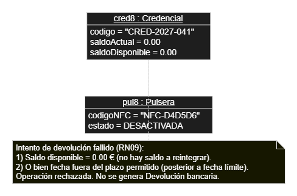

Esta parte de la sección recoge los escenarios de las reglas **R.N.10** (acceso permitido y aforo de cada zona) y **R.N.11** (una sola pulsera activa por credencial). Cada escenario describe el estado inicial, la operación que se intenta y el resultado esperado, con casos válidos, rechazos y límites, y se acompaña de un diagrama de objetos UML.

Los diagramas utilizan las clases, atributos, asociaciones y restricciones del modelo conceptual de 5.1 y de los requisitos de información R.I.01–R.I.13. Se marcan con `/` los atributos derivados. En particular, `/ocupacionActual` de una zona no se almacena: se calcula a partir de los accesos permitidos (entradas menos salidas), tal como recoge R.F.11. Los objetos `Acceso` son inmutables: las lecturas permitidas y denegadas se conservan y solo las permitidas modifican la ocupación (R.I.12). Las fuentes PlantUML se guardan en `docs/diagramas/escenarios/` y los PNG renderizados en `docs/img/escenarios/`.

#### 5.2.10. Escenarios de R.N.10. Acceso permitido y aforo de cada zona

La regla combina tres comprobaciones: que la credencial sea válida para la jornada, que su perfil de acceso permita el tipo de zona y que la zona tenga aforo disponible. Además, las entradas y salidas deben alternarse, para acceder a una zona interior hay que estar dentro del recinto general y las salidas se permiten incluso con la pulsera bloqueada o fuera de horario.

**Datos comunes.**

| Objeto | Valores |
|:--|:--|
| `E-EDI` | `ED-2027`, «Azahar Sound 2027», del 21/05/2027 al 23/05/2027, aforo máximo 15.000 por jornada |
| `zgen : Zona` | `Z-GEN`, «Recinto general», tipo recinto general, aforo 15.000 |
| `zcarpa : Zona` | `Z-CARPA`, «Carpa Alameda», tipo pública, aforo 2.500 |
| `zvip : Zona` | `Z-VIP`, «Patio VIP», tipo VIP, aforo 1.200 |
| `zback : Zona` | `Z-BACK`, «Backstage», tipo profesional, aforo 300 |
| `tcAG : TipoCredencial` | `TC-AG-27`, «Abono General 2027», público, todas las jornadas, perfil general |
| `tcAV : TipoCredencial` | `TC-AV-27`, «Abono VIP 2027», público, todas las jornadas, perfil VIP |
| `tcEV : TipoCredencial` | `TC-EV-27`, «Entrada de viernes 2027», público, 21/05/2027, perfil general |
| `tcOP : TipoCredencial` | `TC-OP-27`, «Acreditación operativa 2027», profesional, todas las jornadas, perfil operativo |
| `tcCO : TipoCredencial` | `TC-CO-27`, «Acreditación completa 2027», profesional, todas las jornadas, perfil completo |
| `sergio : Usuario` | `USR-CTL-01`, «Sergio», rol personal de control del recinto |

Los perfiles de acceso se interpretan según la tabla de R.N.10: el general entra en el recinto general y en las zonas públicas; el VIP añade el Patio VIP; el operativo añade el *backstage*; y el completo entra en todas.

**Coherencia con el modelo conceptual.**

| Regla | R.I. | Elementos del MC que se comprueban | Restricción |
|:--|:--|:--|:--|
| R.N.10 | R.I.02, R.I.03, R.I.07, R.I.08, R.I.12 | `Acceso`–`Credencial`, `Acceso`–`Zona`, `Acceso`–`Usuario` (validador), `Credencial`–`TipoCredencial`, `TipoCredencial`–`Edicion`; atributos `fechaHora`, `tipoMovimiento`, `resultado`, `motivo`, `perfilAcceso`, `validez` | El acceso exige credencial canjeada, pulsera actual activa, jornada cubierta y perfil compatible; la zona no puede superar su aforo; las entradas y salidas se alternan; una zona interior exige estar dentro del recinto general |

**Casos cubiertos.**

| Caso | Operación | Resultado | Escenario |
|:--|:--|:--|:--|
| Perfil VIP entra en el Patio VIP con 1.199 de 1.200 | Entrada | Permitida; ocupación 1.200 | E-10.1 |
| Perfil general intenta entrar en el Patio VIP | Entrada | Denegada; ocupación no cambia | E-10.2 |
| Entrada de viernes usada el sábado | Entrada | Denegada; jornada no cubierta | E-10.3 |
| Carpa con 2.500 de 2.500; una salida y un reintento | Entrada, salida y entrada | Denegada, permitida y permitida | E-10.4 |
| Pulsera bloqueada: salida asistida y reentrada | Salida y entrada | Salida permitida; entrada denegada | E-10.5 |

##### E-10.1. Entrada al Patio VIP con perfil VIP y aforo disponible (válido, límite)

**Contexto.** Elena tiene un abono VIP canjeado y su pulsera `NFC-10A` está activa. A las 17:55 entra en el recinto general y a las 18:00 intenta entrar en el Patio VIP. En ese momento hay 1.199 personas dentro del Patio VIP, cuyo aforo es 1.200.

**Operación.** Se lee `NFC-10A` en el control de acceso del Patio VIP como una entrada.

**Resultado esperado.** El acceso se permite porque el perfil VIP incluye la zona VIP, la credencial es válida para la jornada, la pulsera es la actual y está activa, y hay una plaza libre. Se crea un `Acceso` permitido y la ocupación del Patio VIP pasa de 1.199 a 1.200, justo el aforo, sin superarlo. El acceso previo al recinto general queda registrado y es lo que permite entrar en la zona interior.

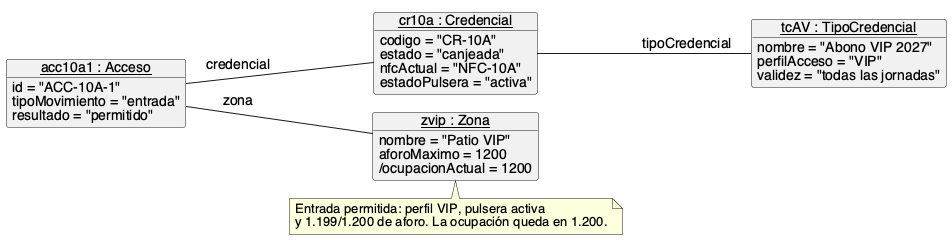

**Comprobación.** El escenario usa `TipoCredencial.perfilAcceso = "VIP"`, `Credencial.estado = "canjeada"` y `Credencial.estadoPulsera = "activa"`. La ocupación se calcula con los accesos permitidos: el acceso `ACC-10A-1` es una entrada permitida al Patio VIP y respeta `{ocupacionActual < aforoMaximo}`. El acceso previo al recinto general, que no se dibuja, es el que habilita la entrada en la zona interior.

##### E-10.2. Perfil general intenta entrar en el Patio VIP (rechazo)

**Contexto.** Lucía tiene un abono general canjeado y su pulsera `NFC-10B` está activa. Ya está dentro del recinto general, pero a las 18:10 intenta entrar en el Patio VIP. Hay 800 personas en el Patio VIP, por debajo de su aforo.

**Operación.** Se lee `NFC-10B` en el control del Patio VIP como una entrada.

**Resultado esperado.** El acceso se deniega porque el perfil general no incluye la zona VIP, aunque la credencial sea válida y haya aforo. Se crea un `Acceso` con resultado denegado y motivo `"perfil general sin acceso a zona VIP"`. La ocupación del Patio VIP sigue en 800 y la credencial no cambia.

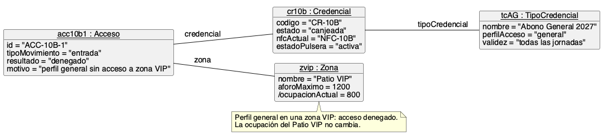

**Comprobación.** El rechazo no depende del aforo: se produce antes de comprobarlo, por incompatibilidad de perfil. El `Acceso` denegado queda registrado, pero no cuenta para la ocupación (R.I.12).

##### E-10.3. Entrada de viernes usada el sábado (rechazo)

**Contexto.** Carmen tiene una entrada de viernes canjeada y su pulsera `NFC-10C` está activa. El 22/05/2027 a las 18:00 intenta entrar en el recinto general.

**Operación.** Se lee `NFC-10C` en el control de acceso del recinto general como una entrada.

**Resultado esperado.** El acceso se deniega porque el tipo de credencial solo es válido el 21/05/2027 y la jornada del 22/05/2027 no está cubierta. Se crea un `Acceso` denegado con motivo `"credencial fuera de su jornada"`. La ocupación del recinto no cambia.

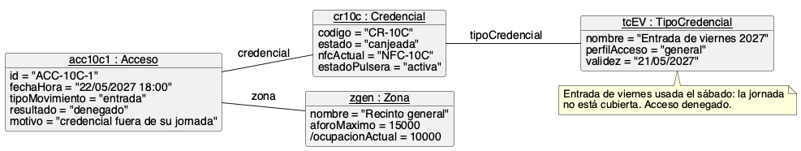

**Comprobación.** Se usa `TipoCredencial.validez = "21/05/2027"` y `Acceso.fechaHora`. La comprobación es por jornada, no por el estado de la credencial: la entrada sigue siendo válida para el viernes, pero no para el sábado.

##### E-10.4. Aforo completo, salida y reintento (límite)

**Contexto.** La Carpa Alameda tiene un aforo de 2.500 personas y está llena: 2.500 dentro. Lucía, con la credencial `CR-10D` y la pulsera `NFC-10D` activa, intenta entrar a las 22:00. Mario, que está dentro con `CR-10E`, sale un minuto después. Lucía lo intenta de nuevo a las 22:02.

**Operación.** Se registran tres lecturas: entrada de Lucía, salida de Mario y entrada de Lucía.

**Resultado esperado.** La primera entrada de Lucía se deniega por aforo completo y no modifica la ocupación. La salida de Mario se permite y baja la ocupación a 2.499. El reintento de Lucía se permite y la ocupación vuelve a 2.500. El aforo nunca se supera y las tres lecturas quedan registradas.

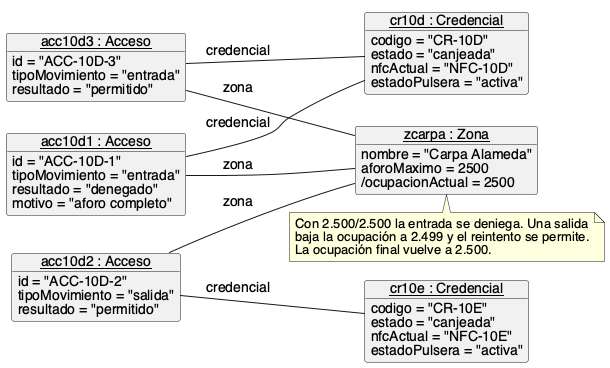

**Comprobación.** Se cumple `{ocupacionActual < aforoMaximo}` para permitir una entrada. La salida se registra como `tipoMovimiento = "salida"` y la entrada denegada no cuenta; por eso el reintento es válido. La secuencia respeta la alternancia entrada/salida.

##### E-10.5. Salida asistida con pulsera bloqueada y reentrada denegada (límite)

**Contexto.** Elena está dentro del recinto general con la credencial `CR-10F`. A las 23:00 pierde la pulsera `NFC-10F` y el personal la bloquea. La ocupación del recinto general es 10.000. Elena intenta volver a entrar a las 23:05 con la misma pulsera bloqueada.

**Operación.** Se registra una salida asistida y, después, un intento de entrada con la pulsera bloqueada.

**Resultado esperado.** La salida se permite aunque la pulsera esté bloqueada, porque las salidas siempre se permiten con ayuda del personal; la ocupación baja de 10.000 a 9.999. La reentrada se deniega por pulsera bloqueada y el intento queda registrado con su motivo. La ocupación no cambia.

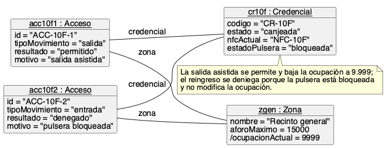

**Comprobación.** El escenario separa la salida (siempre permitida) de la entrada (rechazada por `estadoPulsera = "bloqueada"`). La credencial sigue canjeada y conserva su saldo; la reposición de la pulsera se trata en R.N.11.

**Otros casos de R.N.10.** Estos casos se comprueban con el mismo modelo y no necesitan un diagrama adicional:

| Caso | Resultado esperado |
|:--|:--|
| Entrada a una zona interior sin haber entrado antes en el recinto general | Denegada; primero hay que estar dentro del recinto general |
| Entrada con una credencial en estado `emitida` (sin canjear) | Denegada; se exige una credencial canjeada y una pulsera actual activa |
| Entrada con una credencial `anulada` | Denegada; la credencial no se reactiva |
| Entrada entre las 06:00 y las 12:00 | Denegada; fuera del horario de las jornadas |
| Salida fuera de horario o con la pulsera bloqueada | Permitida con ayuda del personal |
| Reentrada después de una salida | Permitida sin recargo, con las mismas condiciones que la primera entrada |
| Cambio de una zona interior a otra | Se registra la salida de la zona anterior y la entrada en la nueva |
| Aforo del recinto general | Se aplica el menor entre el aforo físico y el autorizado para la edición |

#### 5.2.11. Escenarios de R.N.11. Una sola pulsera activa por credencial

La regla exige que cada credencial tenga una única pulsera actual. Al reponer una pulsera por pérdida, rotura o robo, la anterior deja de servir; el saldo y los accesos siguen asociados a la credencial. El canje pasa la credencial de `emitida` a `canjeada`, el código NFC es único y el titular no se cambia después del primer canje ni de registrar movimientos de saldo.

**Coherencia con el modelo conceptual.**

| Regla | R.I. | Elementos del MC que se comprueban | Restricción |
|:--|:--|:--|:--|
| R.N.11 | R.I.01, R.I.08, R.I.11, R.I.12 | `Credencial` y sus atributos `estado`, `nfcActual`, `estadoPulsera`, `fechaHoraAsignacionPulsera` y `fechaHoraBloqueoPulsera`; `Credencial`–`Usuario` (titular), `Credencial`–`MovimientoSaldo`, `Acceso`–`Credencial` | Una sola pulsera activa por credencial; el código NFC es único; la reposición invalida la pulsera anterior; no se cambia el titular después del canje o de un movimiento; una credencial anulada bloquea su pulsera y conserva el saldo |

**Casos cubiertos.**

| Caso | Operación | Resultado | Escenario |
|:--|:--|:--|:--|
| Reposición de la pulsera A por la B, con saldo y presencia en la Carpa | Reposición | Permitida; B activa y A invalidada | E-11.1 |
| Pago con la pulsera A ya sustituida | Consumo | Rechazado; no hay movimiento | E-11.2 |
| Asignar la pulsera B a otra credencial | Reposición | Rechazada; NFC duplicado | E-11.3 |
| Cambio de titular antes del canje y después del canje | Cambio de titular | Permitido y rechazado, respectivamente | E-11.4 |
| Anulación de una credencial con saldo | Anulación | Pulsera bloqueada; saldo conservado | E-11.5 |

##### E-11.1. Reposición de la pulsera A por la pulsera B (válido)

**Contexto.** Elena tiene la credencial `CR-11A` canjeada, con la pulsera `NFC-A` activa y 15,00 € de saldo. Está dentro de la Carpa Alameda. A las 23:10 acude a atención al cliente porque la pulsera se ha roto; se verifica su identidad y se le asigna la pulsera `NFC-B`.

**Operación.** Se repone la pulsera de la credencial.

**Resultado esperado.** La credencial pasa a tener `nfcActual = "NFC-B"` y `estadoPulsera = "activa"`, con la nueva fecha de asignación. La pulsera `NFC-A` deja de ser la actual y cualquier lector la rechaza. El saldo sigue en 15,00 € y la presencia en la Carpa se mantiene: la reposición no registra una salida ni una entrada y el historial de accesos se conserva.

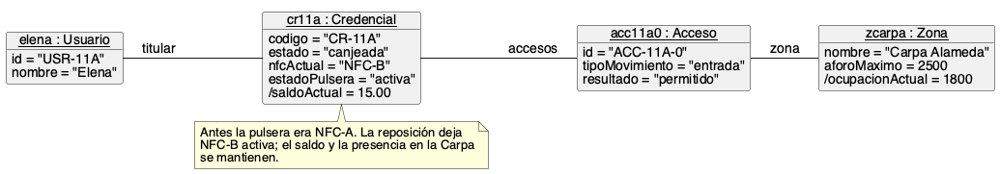

**Comprobación.** Se actualizan los atributos de pulsera de `Credencial` (R.I.08) sin crear una nueva credencial ni un nuevo movimiento de saldo. El `Acceso` anterior sigue apuntando a la misma credencial, por lo que la presencia en la zona no se pierde.

##### E-11.2. Pago con la pulsera A ya sustituida (rechazo)

**Contexto.** La credencial `CR-11B` tiene actualmente `NFC-B` activa y 15,00 € de saldo. Alguien encuentra la antigua pulsera `NFC-A` e intenta pagar una cerveza de 3,50 € en la Barra Azahar.

**Operación.** Se lee `NFC-A` en el lector del punto de venta.

**Resultado esperado.** El cobro se rechaza porque el código leído no coincide con la pulsera actual de ninguna credencial. No se crea ningún `MovimientoSaldo`, el saldo sigue en 15,00 € y el stock de cerveza sigue en 50.

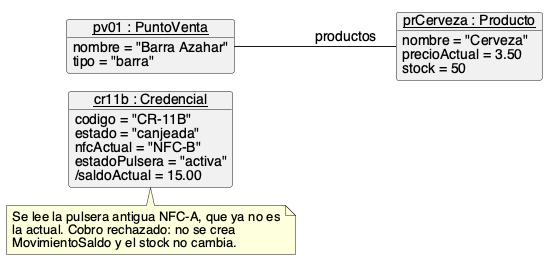

**Comprobación.** El lector busca el código NFC en `Credencial.nfcActual`; `NFC-A` ya no figura como actual. El rechazo no altera el saldo ni el stock, de acuerdo con R.N.06 y R.N.08.

##### E-11.3. Asignar la pulsera B a otra credencial (rechazo)

**Contexto.** `CR-11C` tiene la pulsera `NFC-B` activa. `CR-11D` tiene la pulsera `NFC-C` activa. Se intenta asignar `NFC-B` a `CR-11D`.

**Operación.** Se intenta reponer `CR-11D` con el código `NFC-B`.

**Resultado esperado.** La operación se rechaza porque `NFC-B` ya está asignada a `CR-11C`. El código NFC es único cuando existe, esté la pulsera activa o bloqueada. `CR-11C` conserva `NFC-B` y `CR-11D` conserva `NFC-C`.

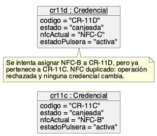

**Comprobación.** Se respeta la unicidad de `Credencial.nfcActual` de R.I.08. La operación es atómica: no se modifica ninguna de las dos credenciales.

##### E-11.4. Cambio de titular antes del canje (válido) y después (rechazo)

**Contexto.** `CR-11E` está emitida, no tiene pulsera y no ha registrado movimientos; su titular es Lucía y se quiere cambiar a Marta. `CR-11F` ya está canjeada, tiene la pulsera `NFC-F` y una recarga de 5,00 €; se intenta cambiar su titular.

**Operación.** Se cambia el titular de `CR-11E` y se intenta el cambio en `CR-11F`.

**Resultado esperado.** El cambio de `CR-11E` se acepta si se cumplen R.N.03 y R.N.05, porque la credencial no se ha canjeado ni tiene movimientos. El cambio de `CR-11F` se rechaza porque ya tiene canje y una recarga registrada. El titular de una credencial canjeada o con movimientos no se modifica.

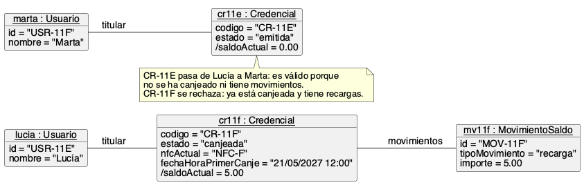

**Comprobación.** El escenario usa `Credencial.estado`, `fechaHoraPrimerCanje` y la existencia de `MovimientoSaldo`. La restricción es independiente del saldo: basta con que haya un movimiento o un canje para bloquear el cambio.

##### E-11.5. Credencial anulada: pulsera bloqueada y saldo conservado (límite)

**Contexto.** La credencial `CR-11G` está anulada, su pulsera `NFC-E` está bloqueada y conserva 15,00 € de saldo. Se intenta canjearla de nuevo y reponer su pulsera.

**Operación.** Se intenta reactivar el canje y asignar una pulsera nueva.

**Resultado esperado.** Las dos operaciones se rechazan: una credencial anulada no se reactiva, no permite un nuevo canje y no admite la reposición de su pulsera. El saldo se conserva para que el titular pueda pedir la devolución según R.N.09.

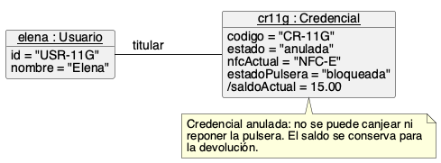

**Comprobación.** El diagrama muestra `estado = "anulada"` y `estadoPulsera = "bloqueada"`. La anulación no borra el saldo ni los movimientos; solo impide el uso de la pulsera y el canje.

**Otros casos de R.N.11.** Estos casos se comprueban con el mismo modelo y no necesitan un diagrama adicional:

| Caso | Resultado esperado |
|:--|:--|
| Asignar una pulsera nueva a una credencial `emitida` sin canjear | Rechazado; primero hay que hacer el canje |
| Reponer la pulsera de una credencial no canjeada | Rechazado; solo se repone una credencial canjeada |
| Cambiar el titular después de una recarga de 5 € sin canje | Rechazado; ya hay un movimiento de saldo |
| Usar una pulsera bloqueada para acceder o pagar | Rechazado; no es una pulsera actual activa |
| Reutilizar el código NFC de una pulsera bloqueada en otra credencial | Rechazado; el código sigue siendo único |
| Asignar una pulsera a una credencial anulada | Rechazado; la credencial no se reactiva, pero conserva el saldo |

## 6. Matrices de trazabilidad

Esta sección relaciona cada requisito de información (R.I.01–R.I.13) y cada regla de negocio (R.N.01–R.N.11) con los elementos del modelo conceptual: entidades, asociaciones y restricciones. La matriz se lee en los dos sentidos: cada fila indica qué elementos del modelo materializan un requisito y cada elemento puede rastrearse hasta los requisitos que lo originan.

Se incluyen las once reglas de negocio, no solo R.N.10 y R.N.11, porque comparten entidades y asociaciones con el resto del modelo y porque la sección 6 debe ser coherente con todo el catálogo. Los escenarios de 5.2 se refieren expresamente a R.N.10 y R.N.11; el resto de reglas se traza aquí sin necesitar un escenario propio en esta entrega.

### 6.1. Criterios y leyenda

- **Entidad (E).** Clase del modelo conceptual con identidad propia. Se incluye en la fila de un requisito cuando este define sus atributos, su identificador o una invariante sobre ellos.
- **Asociación (A).** Relación entre dos entidades, con su cardinalidad y su obligatoriedad. Se incluye cuando el requisito fija esa cardinalidad o una regla que la recorre.
- **Restricción (C).** Invariante o regla que limita los valores o las combinaciones de un elemento. Se incluye cuando el requisito la define o la necesita para comprobarse.
- **Atributo derivado.** Se representa con `/`, como `/saldoActual`, `/saldoDisponible` y `/ocupacionActual`. No se almacena: se calcula a partir de los movimientos o de los accesos, tal como exigen R.I.08, R.I.11 y R.I.12.
- **Trazabilidad de escenarios.** Los escenarios E-10.1 a E-10.5 y E-11.1 a E-11.5 de 5.2 se asocian en 6.4 con las restricciones concretas que comprueban.

**Entidades del modelo conceptual.**

| Código | Entidad | R.I. de origen | Atributos relevantes |
|:--|:--|:--|:--|
| E01 | `Usuario` | R.I.01 | `id`, `email`, `documentoIdentidad`, `fechaNacimiento`, `tipo`, `rol` |
| E02 | `Edicion` | R.I.02 | `id`, `anio`, `fechaInicio`, `fechaFin`, `aforoMaximoJornada` |
| E03 | `Zona` | R.I.03 | `id`, `nombre`, `tipo`, `aforoMaximo`, `/ocupacionActual` |
| E04 | `Escenario` | R.I.04 | `id`, `nombre` |
| E05 | `Artista` | R.I.05 | `id`, `nombreArtistico`, `genero`, `paisOrigen` |
| E06 | `Actuacion` | R.I.06 | `id`, `fechaHoraInicio`, `fechaHoraFin`, `cabezaDeCartel`, `estado` |
| E07 | `TipoCredencial` | R.I.07 | `id`, `nombre`, `destinatario`, `validez`, `perfilAcceso`, `precio`, `cupo` |
| E08 | `Credencial` | R.I.08 | `codigo`, `estado`, `fechaHoraPrimerCanje`, `nfcActual`, `estadoPulsera`, `/saldoActual`, `/saldoDisponible` |
| E09 | `PuntoVenta` | R.I.09 | `id`, `nombre`, `tipo` |
| E10 | `Producto` | R.I.10 | `id`, `nombre`, `categoria`, `precioActual`, `llevaAlcohol`, `stock`, `stockMinimo` |
| E11 | `MovimientoSaldo` | R.I.11 | `id`, `fechaHora`, `tipoMovimiento`, `importe`, `cantidad`, `precioUnitario` |
| E12 | `Acceso` | R.I.12 | `id`, `fechaHora`, `tipoMovimiento`, `resultado`, `motivo` |
| E13 | `Incidencia` | R.I.13 | `id`, `fechaHora`, `tipo`, `gravedad`, `descripcion` |

**Asociaciones del modelo conceptual.**

| Código | Asociación | Cardinalidad | R.I. de origen |
|:--|:--|:--|:--|
| A01 | `Escenario`–`Zona` (`perteneceA`) | `0..*`–`1` | R.I.04 |
| A02 | `Escenario`–`Usuario` (`responsable`) | `0..*`–`0..1` | R.I.04 |
| A03 | `Actuacion`–`Artista` (`actua`) | `0..*`–`1` | R.I.06 |
| A04 | `Actuacion`–`Escenario` (`seCelebraEn`) | `0..*`–`1` | R.I.06 |
| A05 | `Actuacion`–`Edicion` (`perteneceA`) | `0..*`–`1` | R.I.06 |
| A06 | `TipoCredencial`–`Edicion` (`perteneceA`) | `0..*`–`1` | R.I.07 |
| A07 | `Credencial`–`TipoCredencial` (`esDeTipo`) | `0..*`–`1` | R.I.08 |
| A08 | `Credencial`–`Usuario` (`titular`) | `0..*`–`1` | R.I.08 |
| A09 | `Credencial`–`Usuario` (`comprador`) | `0..*`–`0..1` | R.I.08 |
| A10 | `Credencial`–`Usuario` (`adultoResponsable`) | `0..*`–`0..1` | R.I.08 |
| A11 | `Credencial`–`Usuario` (`tramitadorDevolucion`) | `0..*`–`0..1` | R.I.08 |
| A12 | `PuntoVenta`–`Edicion` (`perteneceA`) | `0..*`–`1` | R.I.09 |
| A13 | `PuntoVenta`–`Zona` (`estaEn`) | `0..*`–`1` | R.I.09 |
| A14 | `PuntoVenta`–`Usuario` (`responsable`) | `0..*`–`1` | R.I.09 |
| A15 | `Producto`–`PuntoVenta` (`seVendeEn`) | `0..*`–`1` | R.I.10 |
| A16 | `MovimientoSaldo`–`Credencial` (`perteneceA`) | `0..*`–`1` | R.I.11 |
| A17 | `MovimientoSaldo`–`Producto` (`sobreProducto`) | `0..*`–`0..1` | R.I.11 |
| A18 | `MovimientoSaldo`–`Usuario` (`vendedor`) | `0..*`–`0..1` | R.I.11 |
| A19 | `Acceso`–`Credencial` (`identifica`) | `0..*`–`0..1` | R.I.12 |
| A20 | `Acceso`–`Zona` (`afectaA`) | `0..*`–`1` | R.I.12 |
| A21 | `Acceso`–`Usuario` (`validador`) | `0..*`–`1` | R.I.12 |
| A22 | `Incidencia`–`Edicion` (`perteneceA`) | `0..*`–`1` | R.I.13 |
| A23 | `Incidencia`–`Zona` (`ocurreEn`) | `0..*`–`1` | R.I.13 |
| A24 | `Incidencia`–`Usuario` (`registrador`) | `0..*`–`1` | R.I.13 |

**Restricciones del modelo conceptual.**

| Código | Restricción | R.I./R.N. de origen |
|:--|:--|:--|
| C01 | `Usuario`: `email` y `documentoIdentidad` únicos; todo usuario es asistente, profesional o ambos; el rol solo existe para profesionales y pertenece al enumerado. | R.I.01 |
| C02 | `Edicion`: `anio` único; `fechaInicio` no posterior a `fechaFin` y ambas del año; aforo autorizado positivo y no superior al aforo físico del recinto general. | R.I.02, R.N.04 |
| C03 | `Zona`: `nombre` único; `aforoMaximo > 0`; `tipo` del enumerado; exactamente una zona de tipo recinto general y el resto interiores dentro de ella. | R.I.03 |
| C04 | `Escenario`: `nombre` único; el responsable, si existe, tiene rol de responsable de programación. | R.I.04 |
| C05 | `Artista`: `nombreArtistico` único. | R.I.05 |
| C06 | `Actuacion`: `fechaHoraFin > fechaHoraInicio`; `estado` programada, realizada o cancelada. | R.I.06, R.N.01 |
| C07 | `TipoCredencial`: `nombre` único por edición; destinatario, validez y perfil coherentes con la edición; precio mayor que cero para público e igual a cero para profesional; cupo entero positivo. | R.I.07, R.N.02 |
| C08 | `TipoCredencial`: edición, destinatario, validez y perfil inmutables si ya tiene credenciales; el cupo no puede quedar por debajo de las no anuladas. | R.I.07, R.N.02 |
| C09 | `Credencial`: `codigo` único; `estado` emitida, canjeada o anulada; una anulada no se reactiva; `fechaHoraPrimerCanje` se conserva. | R.I.08, R.N.11 |
| C10 | `Credencial`: titular y comprador coherentes con el destinatario; comprador obligatorio solo en entradas de público; las acreditaciones son gratuitas. | R.I.08 |
| C11 | `Credencial`: `nfcActual` único cuando existe; `estadoPulsera` activa o bloqueada; fechas de asignación y bloqueo coherentes; sin valor antes del canje. | R.I.08, R.N.10, R.N.11 |
| C12 | `Credencial`: `/saldoActual` = recargas − consumos − devolución pagada; `/saldoDisponible` = 0 si hay devolución solicitada; datos de devolución coherentes y una sola solicitud. | R.I.08, R.N.06, R.N.09 |
| C13 | `PuntoVenta`: `nombre` único por edición; `tipo` barra, *food truck* o tienda; responsable con rol de punto de venta; edición inmutable si ya tiene productos. | R.I.09 |
| C14 | `Producto`: `nombre` único por punto de venta; categoría del enumerado; `precioActual > 0`; `stock` y `stockMinimo` no negativos; punto de venta inmutable si ya tiene consumos. | R.I.10 |
| C15 | `MovimientoSaldo`: `cantidad` entera positiva; `precioUnitario` histórico; `importe = cantidad × precioUnitario`; campos exclusivos según el tipo; confirmado e inmutable; identificador idempotente. | R.I.11 |
| C16 | `Acceso`: identificador único; tipo entrada o salida; resultado permitido o denegado; motivo obligatorio si se deniega; fecha con segundos; lectura inmutable; credencial opcional solo para código desconocido; validador con rol de control. | R.I.12 |
| C17 | `Incidencia`: tipo sanitaria, seguridad o técnica; gravedad leve, grave o muy grave; fecha dentro de una jornada; sin datos clínicos ni identidad de pacientes. | R.I.13 |
| C18 | Programación: duración entre 30 minutos y 3 horas; actuación entera dentro de una jornada; sin solapes en el mismo escenario y con 30 minutos de margen; un artista no actúa simultáneamente en dos escenarios. | R.N.01 |
| C19 | Precio y cupo: no se emite por encima del cupo; el precio pagado no cambia; el precio del tipo puede actualizarse para nuevas emisiones. | R.N.02 |
| C20 | Compra: máximo 4 entradas de público no anuladas por comprador y edición; las acreditaciones no cuentan; una anulación libera plaza; el comprador no cambia. | R.N.03 |
| C21 | Aforo de jornada: suma de credenciales no anuladas ≤ aforo autorizado; un titular no puede tener dos credenciales no anuladas para la misma jornada; no se reduce el aforo autorizado por debajo de lo reservado o de la ocupación. | R.N.04 |
| C22 | Menores: titular menor de 16 años exige adulto de al menos 18 con credencial para las mismas jornadas y autorización firmada antes del canje; la entrada del adulto se registra primero. | R.N.05 |
| C23 | Saldo: nunca negativo; recargas de 5 a 200 €; sin movimientos tras el cierre ni tras solicitar la devolución; el consumo exige credencial canjeada, pulsera actual activa, jornada cubierta y producto de la misma edición. | R.N.06 |
| C24 | Alcohol: prohibido a titulares menores de 18 años en el momento de la venta; la edad se calcula con la fecha de nacimiento y la fecha y hora local. | R.N.07 |
| C25 | Stock: no se vende más que el disponible; cantidad entera positiva; un rechazo no descuenta stock ni saldo; el stock nunca queda negativo. | R.N.08 |
| C26 | Devolución: una por credencial, sin comisión, por el saldo completo positivo desde el fin de la última jornada; importe inmutable; pago único y no anterior a la solicitud. | R.N.09 |
| C27 | Acceso: credencial canjeada, pulsera actual activa, jornada cubierta y perfil compatible; entradas desde las 12:00 y antes de las 06:00 del día siguiente; no se supera el aforo; entradas y salidas alternadas; zona interior exige estar en el recinto general; la salida siempre se permite; la reentrada no tiene recargo. | R.N.10 |
| C28 | Pulsera: una sola activa por credencial; NFC único; la reposición invalida la anterior; solo se repone una credencial canjeada; el titular no cambia tras el canje o un movimiento; la anulación bloquea la pulsera y conserva el saldo. | R.N.11 |

### 6.2. Matriz de requisitos de información

| R.I. | Entidades | Asociaciones | Restricciones |
|:--|:--|:--|:--|
| R.I.01 | E01 | — | C01 |
| R.I.02 | E02 | — | C02 |
| R.I.03 | E03 | — | C03 |
| R.I.04 | E04, E03, E01 | A01, A02 | C04 |
| R.I.05 | E05 | — | C05 |
| R.I.06 | E06, E05, E04, E02 | A03, A04, A05 | C06 |
| R.I.07 | E07, E02 | A06 | C07, C08 |
| R.I.08 | E08, E07, E01 | A07, A08, A09, A10, A11 | C09, C10, C11, C12 |
| R.I.09 | E09, E02, E03, E01 | A12, A13, A14 | C13 |
| R.I.10 | E10, E09 | A15 | C14 |
| R.I.11 | E11, E08, E10, E01 | A16, A17, A18 | C15 |
| R.I.12 | E12, E08, E03, E01 | A19, A20, A21 | C16 |
| R.I.13 | E13, E02, E03, E01 | A22, A23, A24 | C17 |

### 6.3. Matriz de reglas de negocio

| R.N. | Entidades | Asociaciones | Restricciones |
|:--|:--|:--|:--|
| R.N.01 | E06, E04, E05, E02 | A03, A04, A05 | C06, C18 |
| R.N.02 | E07, E08 | A06, A07 | C07, C08, C19 |
| R.N.03 | E01, E07, E08, E02 | A06, A07, A08, A09 | C20 |
| R.N.04 | E02, E07, E08 | A06, A07, A08 | C02, C21 |
| R.N.05 | E01, E08, E12 | A08, A10, A19 | C22 |
| R.N.06 | E08, E11, E10, E07, E02 | A07, A16, A17 | C12, C23 |
| R.N.07 | E01, E08, E10, E11 | A08, A16, A17 | C24 |
| R.N.08 | E10, E11 | A16, A17 | C25 |
| R.N.09 | E08, E11 | A11, A16 | C12, C26 |
| R.N.10 | E08, E12, E03, E07, E02, E01 | A06, A07, A19, A20, A21 | C09, C11, C27 |
| R.N.11 | E08, E01, E11, E12 | A08, A16, A19 | C09, C11, C12, C28 |

### 6.4. Trazabilidad de los escenarios de 5.2

| Escenario | Regla | Restricciones que comprueba | Elementos del MC utilizados |
|:--|:--|:--|:--|
| E-10.1 | R.N.10 | C27, C09, C11 | `Acceso`, `Credencial`, `Zona`, `TipoCredencial` |
| E-10.2 | R.N.10 | C27 | `Acceso`, `Credencial`, `Zona`, `TipoCredencial` |
| E-10.3 | R.N.10 | C27, C09 | `Acceso`, `Credencial`, `Zona`, `TipoCredencial` |
| E-10.4 | R.N.10 | C27 | `Acceso`, `Credencial`, `Zona` |
| E-10.5 | R.N.10 | C27, C11 | `Acceso`, `Credencial`, `Zona` |
| E-11.1 | R.N.11 | C28, C11, C12 | `Acceso`, `Credencial`, `Zona`, `Usuario` |
| E-11.2 | R.N.11 | C28, C11, C25 | `Credencial`, `Producto`, `PuntoVenta` |
| E-11.3 | R.N.11 | C28, C11 | `Credencial` |
| E-11.4 | R.N.11 | C28, C09 | `Credencial`, `Usuario`, `MovimientoSaldo` |
| E-11.5 | R.N.11 | C28, C09, C12 | `Credencial`, `Usuario` |

Los diez escenarios cubren las dos reglas asignadas y sus casos válidos, de rechazo y de límite. E-10.1 y E-10.4 comprueban el límite del aforo; E-10.2, E-10.3 y E-10.5 comprueban rechazos por perfil, jornada y pulsera; E-11.1 y E-11.4 comprueban operaciones válidas; E-11.2, E-11.3 y E-11.5 comprueban rechazos y el límite de la credencial anulada.

### 6.5. Comprobación de cobertura

La cobertura se comprueba en los dos sentidos. Primero, cada requisito tiene al menos una entidad, una asociación o una restricción asociada, salvo R.I.01, R.I.02, R.I.03 y R.I.05, que son entidades raíz y por tanto no tienen asociaciones. Segundo, cada elemento del modelo aparece en al menos un requisito.

**Entidades y requisitos que las utilizan.**

| Entidad | Requisitos |
|:--|:--|
| E01 `Usuario` | R.I.01, R.I.04, R.I.08, R.I.09, R.I.11, R.I.12, R.I.13, R.N.03, R.N.05, R.N.07, R.N.10, R.N.11 |
| E02 `Edicion` | R.I.02, R.I.06, R.I.07, R.I.09, R.I.13, R.N.01, R.N.03, R.N.04, R.N.06, R.N.10 |
| E03 `Zona` | R.I.03, R.I.04, R.I.09, R.I.12, R.I.13, R.N.10 |
| E04 `Escenario` | R.I.04, R.I.06, R.N.01 |
| E05 `Artista` | R.I.05, R.I.06, R.N.01 |
| E06 `Actuacion` | R.I.06, R.N.01 |
| E07 `TipoCredencial` | R.I.07, R.I.08, R.N.02, R.N.03, R.N.04, R.N.06, R.N.10 |
| E08 `Credencial` | R.I.08, R.I.11, R.I.12, R.N.02, R.N.03, R.N.04, R.N.05, R.N.06, R.N.07, R.N.09, R.N.10, R.N.11 |
| E09 `PuntoVenta` | R.I.09, R.I.10 |
| E10 `Producto` | R.I.10, R.I.11, R.N.06, R.N.07, R.N.08 |
| E11 `MovimientoSaldo` | R.I.11, R.N.06, R.N.07, R.N.08, R.N.09, R.N.11 |
| E12 `Acceso` | R.I.12, R.N.05, R.N.10, R.N.11 |
| E13 `Incidencia` | R.I.13 |

**Asociaciones y requisitos que las utilizan.**

| Asociación | Requisitos |
|:--|:--|
| A01 `Escenario`–`Zona` | R.I.04 |
| A02 `Escenario`–`Usuario` | R.I.04 |
| A03 `Actuacion`–`Artista` | R.I.06, R.N.01 |
| A04 `Actuacion`–`Escenario` | R.I.06, R.N.01 |
| A05 `Actuacion`–`Edicion` | R.I.06, R.N.01 |
| A06 `TipoCredencial`–`Edicion` | R.I.07, R.N.02, R.N.03, R.N.04, R.N.06, R.N.10 |
| A07 `Credencial`–`TipoCredencial` | R.I.08, R.N.02, R.N.03, R.N.04, R.N.06, R.N.10 |
| A08 `Credencial`–`Usuario` (titular) | R.I.08, R.N.03, R.N.04, R.N.05, R.N.07, R.N.11 |
| A09 `Credencial`–`Usuario` (comprador) | R.I.08, R.N.03 |
| A10 `Credencial`–`Usuario` (adulto responsable) | R.I.08, R.N.05 |
| A11 `Credencial`–`Usuario` (tramitador) | R.I.08, R.N.09 |
| A12 `PuntoVenta`–`Edicion` | R.I.09 |
| A13 `PuntoVenta`–`Zona` | R.I.09 |
| A14 `PuntoVenta`–`Usuario` | R.I.09 |
| A15 `Producto`–`PuntoVenta` | R.I.10 |
| A16 `MovimientoSaldo`–`Credencial` | R.I.11, R.N.06, R.N.07, R.N.08, R.N.09, R.N.11 |
| A17 `MovimientoSaldo`–`Producto` | R.I.11, R.N.06, R.N.07, R.N.08 |
| A18 `MovimientoSaldo`–`Usuario` | R.I.11 |
| A19 `Acceso`–`Credencial` | R.I.12, R.N.05, R.N.10, R.N.11 |
| A20 `Acceso`–`Zona` | R.I.12, R.N.10 |
| A21 `Acceso`–`Usuario` | R.I.12, R.N.10 |
| A22 `Incidencia`–`Edicion` | R.I.13 |
| A23 `Incidencia`–`Zona` | R.I.13 |
| A24 `Incidencia`–`Usuario` | R.I.13 |

**Restricciones y requisitos que las originan.**

| Restricción | Requisitos |
|:--|:--|
| C01 | R.I.01 |
| C02 | R.I.02, R.N.04 |
| C03 | R.I.03 |
| C04 | R.I.04 |
| C05 | R.I.05 |
| C06 | R.I.06, R.N.01 |
| C07 | R.I.07, R.N.02 |
| C08 | R.I.07, R.N.02 |
| C09 | R.I.08, R.N.11 |
| C10 | R.I.08 |
| C11 | R.I.08, R.N.10, R.N.11 |
| C12 | R.I.08, R.N.06, R.N.09 |
| C13 | R.I.09 |
| C14 | R.I.10 |
| C15 | R.I.11 |
| C16 | R.I.12 |
| C17 | R.I.13 |
| C18 | R.N.01 |
| C19 | R.N.02 |
| C20 | R.N.03 |
| C21 | R.N.04 |
| C22 | R.N.05 |
| C23 | R.N.06 |
| C24 | R.N.07 |
| C25 | R.N.08 |
| C26 | R.N.09 |
| C27 | R.N.10 |
| C28 | R.N.11 |

**Resumen de cobertura.**

| Conjunto | Total | Con al menos una referencia | Sin referencia |
|:--|:-:|:-:|:-:|
| Requisitos de información | 13 | 13 | 0 |
| Reglas de negocio | 11 | 11 | 0 |
| Entidades | 13 | 13 | 0 |
| Asociaciones | 24 | 24 | 0 |
| Restricciones | 28 | 28 | 0 |
| Escenarios de 5.2 | 10 | 10 | 0 |

La cobertura es completa. Las entidades raíz R.I.01–R.I.03 y R.I.05 no necesitan asociaciones porque el propio requisito declara que son independientes; su información se relaciona con el resto a través de las entidades que las referencian en A02, A08, A09, A10, A11, A14, A18, A21 y A24. Las reglas R.N.10 y R.N.11, que son las que se desarrollan con escenarios en 5.2, quedan trazadas con las restricciones C27 y C28, apoyadas en C09, C11 y C12 para la credencial y la pulsera. No queda ningún elemento del modelo sin requisito de origen ni ningún requisito sin elemento que lo materialice.

-- fin entregable 2 --

## 7. Modelo relacional en 3FN

- Relaciones obtenidas al aplicar la transformación del modelo conceptual.

### 7.1.  Justificación de la estrategia de transformación de jerarquías

- si se identificaron jerarquías en el MC.

### 8. Matriz de trazabilidad MC/SQL (opcional):

- Restricciones sobre el MC / Elementos del modelo tecnológico (SQL) (Triggers, checks, etc.)
- Incluir Reglas de negocio — Constraints/Triggers en las matrices de trazabilidad para el entregable 3

|       | EntidadX   | AsociaciónX  | RestricciónX  | Entidad2 ...   | 
|:-------|:-------|:-------|:-------|:-------|
| TABLA-1 |        |        |        |        |
| TABLA-2 |        |        |        |        |
| TABLA-3 |        |        |        |        |
| TABLA-4 |        |        |        |        |
| TRIG-1 |        |        |        |        |
| TRIG-2 | X      | X      |        | X      |
| TRIG-3 |        | X      |        | X      |
| TRIG-4 |        |        | X      |        |
| CONST-1 |        |        |        |        |
| CONST-2 | X      | X      |        | X      |
| CONST-3 |        | X      |        | X      |
| CONST-4 |        |        | X      |        |

Se consideran todo tipo de constraints declarativas (aquellas definidas durante el CREATE TABLE).
-- fin entregable 3 --

## Referencias

1. Redacción Digital (10/06/2026). «Pulseras para el Mallorca Live Occident 2026: puntos de recogida y cómo funcionan». *Última Hora*. <https://www.ultimahora.es/xaloc/dudas-respuestas/2026/06/10/2646579/pulseras-para-mallorca-live-festival-2026-puntos-recogida-como-funcionan.html>
2. Arenal Sound. *Condiciones generales de la edición de 2023*. <https://www.arenalsound.com/wp-content/uploads/2022/10/AS2023-ESP-Condiciones-generales.pdf>
3. Mora, A. (04/08/2026). «Ni comida, ni bebida, ni reacceso: multa de 320.000 € al Reggaeton Beach Festival por prácticas abusivas». *El Español*. <https://www.elespanol.com/el-cultural/escenarios/musica/20260804/comida-bebida-reacceso-multa-eur-reggaeton-beach-festival-practicas-abusivas/1003744343870_0.html>
4. Ley 12/2003, de 24 de noviembre, para la reforma de la Ley 4/1997, de 9 de julio, de Prevención y Asistencia en materia de Drogas. *Boletín Oficial de la Junta de Andalucía*, n.º 237, de 10 de diciembre de 2003. Copia del Ministerio de Sanidad: <https://www.sanidad.gob.es/ca/alcoholJovenes/docs/autonomica/Ley12_2003_AND.pdf>
5. Cohn, M. (2004). *User Stories Applied: For Agile Software Development*. Addison-Wesley.
6. Departamento de Lenguajes y Sistemas Informáticos, Universidad de Sevilla (2026). Material de la asignatura Introducción a la Ingeniería del Software y los Sistemas de Información I, curso 2026/27: tema 4 (requisitos), tema 5 (modelo conceptual), tema 8 (transformación al modelo relacional), tema 13 (pruebas), soluciones de los ejercicios de Eventos y Ticketing y norma del proyecto.
7. Patton, J. (2014). *User Story Mapping: Discover the Whole Story, Build the Right Product*. O'Reilly Media.
8. Reglamento (UE) 2016/679 del Parlamento Europeo y del Consejo, de 27 de abril de 2016, relativo a la protección de las personas físicas en lo que respecta al tratamiento de datos personales y a la libre circulación de estos datos (Reglamento general de protección de datos). *Diario Oficial de la Unión Europea*, L 119, de 4 de mayo de 2016. <https://eur-lex.europa.eu/legal-content/ES/TXT/?uri=CELEX:32016R0679>
9. MariaDB. *MariaDB Server Documentation*. <https://mariadb.com/docs/server/>
