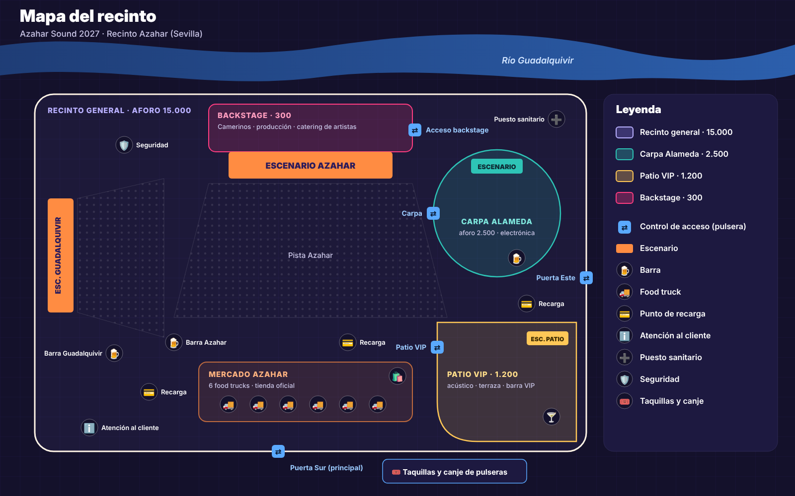
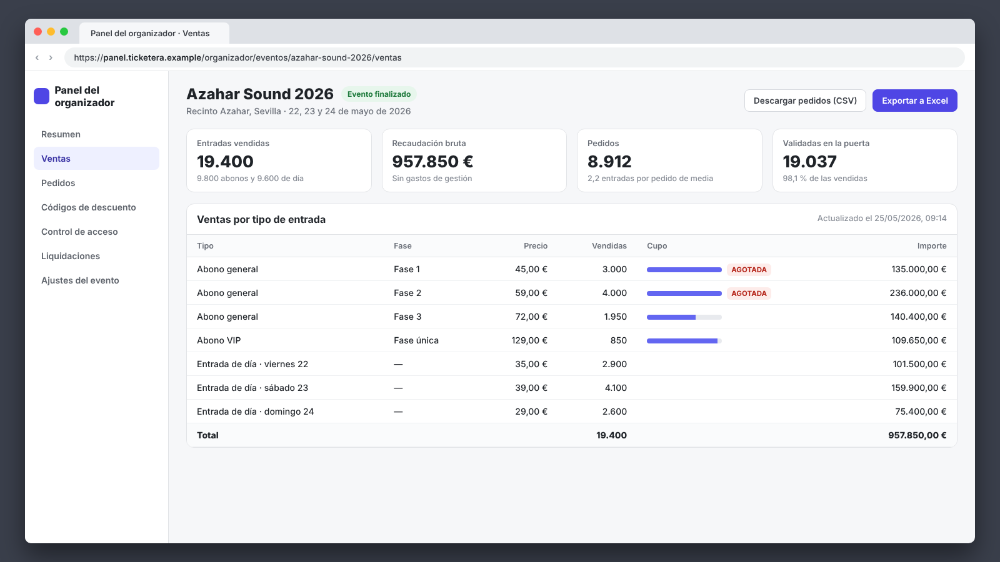
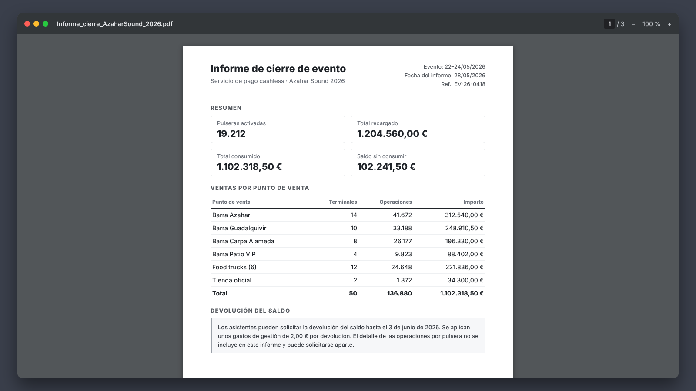
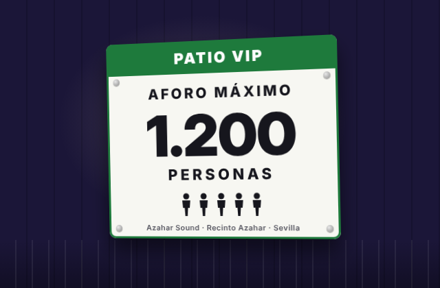
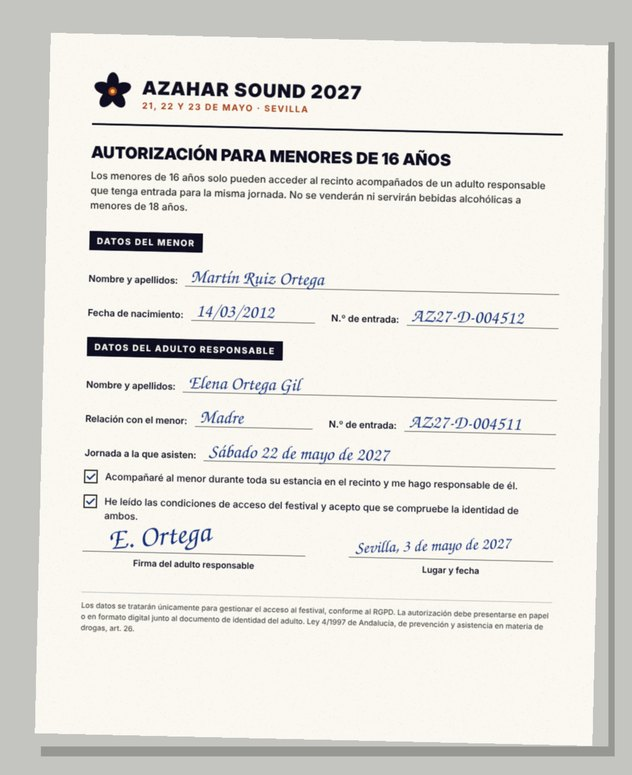
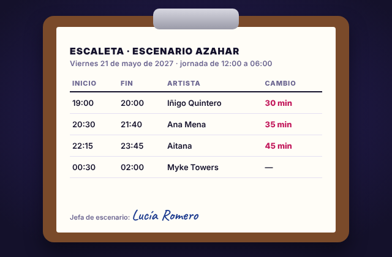
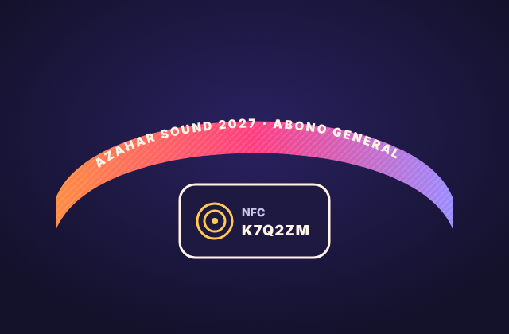
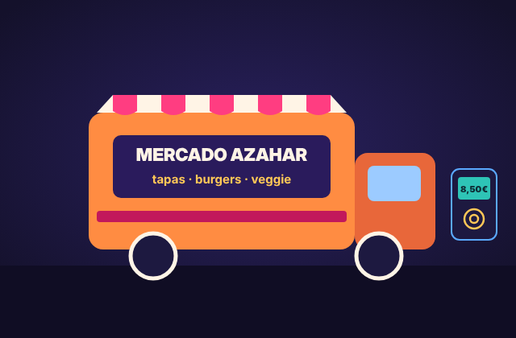

# Backstage: sistema de información para la gestión de un festival de música

## Miembros del grupo L8-AM-2

1. Díaz Camacho, Andrés
1. González Ortega, Pablo
1. Hekmatara, Seyedehdarya
1. Muñoz García, Antonio

## 1. Introducción al problema

En este proyecto vamos a diseñar **Backstage**, el sistema de información de **Azahar Sound**, un festival de música que se celebra cada mayo en Sevilla. La idea es que todo lo que hoy se lleva por separado (el cartel, las entradas, las acreditaciones del personal, las pulseras, los accesos a cada zona, las barras y las incidencias) pase a un único sistema conectado, con toda la información en el mismo sitio.

Hemos elegido este tema porque es un mundo que conocemos bien como público y porque se ve muy claro lo que aporta un buen sistema de información. Los festivales grandes ya lo tienen casi todo integrado. En el Mallorca Live, por ejemplo, la misma pulsera sirve para entrar y para pagar; si la pierdes y la tienes asociada a tu cuenta, se bloquea y te dan otra por 5 €, y el saldo que sobra se devuelve sin gastos de gestión. En el Arenal Sound las entradas son nominativas y el titular se cambia desde la web. Pero muchos festivales pequeños y medianos todavía trabajan con herramientas sueltas: una ticketera por un lado, el proveedor de las pulseras por otro, hojas de cálculo y grupos de WhatsApp, y cada área por su cuenta.

Además, hay problemas que siguen siendo actuales para todo el sector. En 2026 el Ministerio de Consumo multó con 320.000 € al Reggaeton Beach Festival, entre otras cosas por poner trabas a la devolución del saldo de las pulseras, no devolver los sobrantes de menos de 2 € y cobrar por salir y volver a entrar.

Azahar Sound no existe: nos lo hemos inventado para el proyecto, igual que su recinto. Aun así, lo hemos planteado como si fuera un encargo real, y su situación es la de muchos festivales medianos de verdad.

**El cliente**

Azahar Sound lo organiza una pequeña promotora sevillana. Es un festival de pop y música urbana que empezó en 2024 con unas 21.000 personas entre los tres días, en 2025 llegó a 30.000 y en 2026 a 39.000. En 2027 celebra su cuarta edición, y este es el cartel que nos hemos imaginado para ella, con artistas reales que este año han estado en festivales como el Arenal Sound, Icónica Sevilla o el Puro Latino:

- **Fechas:** será del viernes 21 al domingo 23 de mayo de 2027 en el Recinto Azahar, junto al Guadalquivir. El festival se celebra siempre allí.
- **Aforo:** la autorización permite 15.000 personas por jornada.
- **Jornadas:** cada jornada empieza a las 12:00 y acaba a las 06:00 del día siguiente, porque los conciertos de la noche pasan de medianoche.
- **Escenarios:** el Azahar, que es el principal; el Guadalquivir; la Carpa Alameda, de electrónica; y el Patio, acústico y dentro de la zona VIP.
- **Zonas:** el recinto general tiene un aforo de 15.000 personas y, dentro de él, hay tres zonas con aforo propio: la Carpa Alameda (2.500), el Patio VIP (1.200) y el *backstage* (300).
- **Entradas:** se venden abonos generales, abonos VIP y entradas de día, por fases. Cuanto más tarde se compran, más caras son.
- **Personal:** trabajan unos 600 profesionales de la promotora, de producción, de seguridad, del puesto sanitario y de las barras, además de los artistas y sus equipos.
- **Puntos de venta:** hay cuatro barras, seis *food trucks* y una tienda, y en todos ellos se paga solo con la pulsera (lo que se llama *cashless*).

Así es el recinto, con sus zonas, sus escenarios, los puntos de venta y los controles de acceso:

**Usuarios**

El sistema lo usará el público, que compra sus entradas, recarga la pulsera y consulta el cartel, y también el personal del festival: dirección, programación, escenarios, accesos, atención al cliente, barras, seguridad y sanitarios. Los diez tipos de usuario están explicados en el apartado [3.2](#32-usuarios-del-sistema).

**Situación actual**

El festival ha crecido muy rápido, pero sigue funcionando con las herramientas de cuando era pequeño. No es que no use tecnología: es que cada área tiene la suya y casi nada está conectado.

| Área | Cómo se lleva ahora | Qué pasa |
|:--|:--|:--|
| Venta de entradas | Una ticketera externa vende las entradas y su aplicación lee los códigos en la puerta principal. | La entrada va a nombre del comprador, pero no se sabe quién la usa. Para trabajar con las ventas hay que exportarlas a Excel. |
| Pulseras y pagos | Un proveedor alquila para el fin de semana las pulseras, los lectores de las barras y los puntos de recarga. | Las recargas, los consumos y el saldo se quedan en su plataforma. La promotora recibe un informe resumido días después, y las condiciones para devolver el saldo las pone el proveedor. |
| Acreditaciones | Un formulario en línea y una hoja de cálculo compartida. | La edita mucha gente a la vez, hay filas repetidas y, para saber a qué zonas puede pasar alguien, hay que buscarlo en la hoja. |
| Programación | Una hoja de cálculo con los horarios, que se manda en PDF por correo y por WhatsApp. | Si un horario cambia, cada uno se entera cuando se entera. |
| Zonas VIP y *backstage* | Pulseras de colores y personal que las mira en cada puerta. | No queda registro de quién entra ni de cuánta gente hay dentro. |
| Barras y *food trucks* | Cada punto de venta lleva su *stock* en su propia hoja. | Lo que falta se pide por el walkie, y nadie ve el total de lo vendido hasta el informe del proveedor. |
| Incidencias | Se avisan por walkie o por WhatsApp, y la empresa de seguridad y el servicio sanitario hacen cada uno su propio informe. | No hay un registro común y no se pueden comparar unas ediciones con otras. |

Cuando termina el festival, alguien de la promotora se pasa una semana cruzando las exportaciones de cada herramienta para hacer la memoria de la edición.

Así ve hoy la promotora las ventas, en el panel de la ticketera. Para cruzarlas con cualquier otra cosa hay que exportarlas:

Y así le llegan los datos de las barras: un informe en PDF que manda el proveedor de las pulseras cuando ya ha pasado el festival.

**Problemas**

Con esta forma de trabajar, la promotora tiene dos tipos de problemas.

Por un lado, cosas que los festivales grandes ya han resuelto con sistemas integrados y que Azahar Sound todavía no:

- **Las entradas no están ligadas a una persona.** Si la entrada no tiene un titular, no se puede frenar la reventa ni cambiarla de nombre de forma ordenada. En 2026 se revendieron unas 450 entradas en webs no oficiales por más del doble de su precio.
- **La pulsera de pago y el acceso a las zonas van por separado.** Si alguien pierde la pulsera, pierde su saldo, y en las zonas VIP y en el *backstage* no se sabe quién ha entrado.
- **Cada área trabaja con su versión de los datos.** El cartel, las acreditaciones y el *stock* están en hojas distintas que no siempre coinciden.
- **No hay datos fiables para decidir.** Saber cuántas entradas se venden en cada fase, qué jornada se llena más, qué barra vende más o dónde hay más incidencias cuesta días de trabajo, y aun así los números no siempre cuadran.

Por otro, problemas que siguen siendo actuales para todo el sector:

- **La devolución del saldo de las pulseras.** Muchos festivales ponen plazos cortos y comisiones, y Consumo ya ha empezado a multar por ello. En 2026 Azahar Sound recibió más de 300 reclamaciones, porque el proveedor solo daba 10 días para pedir el saldo y cobraba 2 € por devolverlo.
- **La venta de alcohol a menores.** En Andalucía está prohibida por debajo de los 18 años, y en una barra con mucha gente es fácil que se escape si no hay forma de saber la edad de quien paga.
- **Los datos personales.** Hay datos delicados, como los documentos de identidad, los datos de los menores o las incidencias sanitarias, y ahora mismo están repartidos en hojas y correos.

**Qué espera el cliente**

La promotora quiere estrenar en 2027 un sistema propio con el que pueda:

1. Tener toda la información del festival en un único sistema, sin datos repetidos entre herramientas.
2. Que todas las áreas (taquillas, accesos, barras, producción y dirección) trabajen sobre los mismos datos y vean los cambios al momento.
3. Que el propio sistema haga cumplir las normas del festival: el máximo de entradas por comprador, la edad para el alcohol, el aforo de cada zona o la devolución del saldo sin comisiones.
4. Dejar de depender de los proveedores para tener sus propios datos.
5. Tener datos para decidir y para mejorar cada edición: ventas por fase, ocupación, consumos e incidencias.
6. Poder crecer: añadir zonas, puntos de venta o tipos de entrada sin cambiar de herramienta.

## 2. Glosario de términos

Estos son los términos propios de los festivales que usamos en el documento, ordenados alfabéticamente.

| Término | Definición | Imagen |
|:--|:--|:-:|
| **Abono** | Entrada que vale para todas las jornadas de una edición. Puede ser general o VIP. | |
| **Acreditación** | Credencial gratuita que el festival da a un profesional (artista, técnico, proveedor, vigilante, sanitario…) y que dice a qué zonas puede pasar. |  |
| **Actuación** | Concierto de un artista en un escenario, con hora de inicio y de fin, dentro de una edición. | |
| **Aforo** | Número máximo de personas que puede haber a la vez en el recinto o en una zona. Lo fija la autorización del evento. |  |
| **Autorización de menores** | Documento que firma el adulto responsable para que un menor de 16 años pueda entrar, y en el que se compromete a acompañarlo durante toda la jornada. |  |
| **Backstage** | Zona restringida detrás de los escenarios, con los camerinos y la producción, a la que solo se entra con acreditación. Le da nombre a nuestro sistema. | |
| **Cabeza de cartel** | Cada uno de los artistas principales de una jornada, los que más público atraen. Salen destacados en el cartel. | |
| **Cambio de escenario** | Tiempo entre dos actuaciones del mismo escenario para desmontar el equipo de un artista y montar el del siguiente. En Azahar Sound es de 30 minutos como mínimo. | |
| **Canje** | Cambio de la credencial (la entrada, en papel o en el móvil, o la acreditación) por la pulsera, en las taquillas o en la puerta. Desde ese momento la pulsera queda activa. | |
| **Cartel** | Lista de los artistas de una edición, organizada por jornadas. En inglés, *line-up*. |  |
| **Cashless** | Sistema de pago sin efectivo: todo se paga con la pulsera, a la que antes se le ha cargado saldo. | |
| **Comprador** | Asistente que paga una entrada. Puede comprarla para él o para otra persona, que será su titular. | |
| **Credencial** | Lo que da derecho a entrar en el festival: una entrada, para el público, o una acreditación, para los profesionales. Al canjearla se le asocia una pulsera. | |
| **Devolución de saldo** | Reembolso del saldo que sobra cuando termina el festival. | |
| **Edición** | Cada vez que se celebra el festival, una por año. Por ejemplo, Azahar Sound 2027. | |
| **Entrada de día** | Entrada que solo vale para una jornada concreta. | |
| **Entrada nominativa** | Entrada a nombre de una persona, el titular, que tiene que enseñar su documento para entrar. |  |
| **Escaleta** | Hoja con el orden y el horario de las actuaciones de un escenario en una jornada. |  |
| **Escenario** | Sitio donde actúan los artistas. Azahar Sound tiene cuatro: Azahar, Guadalquivir, Carpa Alameda y Patio. | |
| **Fase de venta** | Periodo en el que un tipo de entrada se vende a un precio y con un cupo máximo. Cuando se acaba el cupo o termina el plazo, empieza la fase siguiente, que es más cara. | |
| **Food truck** | Camión de comida que funciona como punto de venta dentro del recinto. | |
| **Incidencia** | Cualquier problema que pasa durante una jornada y que hay que dejar registrado: sanitario, de seguridad o técnico. | |
| **Jornada** | Cada día de festival. Empieza a las 12:00 y termina a las 06:00 del día siguiente, porque los conciertos siguen después de medianoche. | |
| **Profesional** | Persona que trabaja en el festival, ya sea de la promotora o de otra empresa. Entra con una acreditación. | |
| **Promotora** | Empresa que organiza el festival. La de Azahar Sound es nuestro cliente. | |
| **Pulsera NFC** | Pulsera con un chip que se lee acercándola a un lector, sin contacto. Sirve para entrar en las zonas y para pagar. |  |
| **Punto de venta** | Barra, *food truck* o tienda del recinto donde se paga con la pulsera. |  |
| **Recarga** | Ingreso de saldo para pagar con la pulsera, por la web o en un punto de recarga del recinto. | |
| **Reentrada** | Volver a entrar en el recinto o en una zona después de haber salido. | |
| **Reventa** | Venta de una entrada por alguien que no es el festival, normalmente por encima de su precio original. | |
| **Saldo** | Dinero que tiene una credencial para pagar con su pulsera: lo que se ha recargado menos lo que se ha gastado y lo que ya se ha devuelto. | |
| **Titular** | Persona a cuyo nombre está una entrada y que la va a usar para entrar. | |
| **Zona** | Parte del recinto con su propio aforo y control de acceso: el recinto general y, dentro de él, la Carpa Alameda, el Patio VIP y el *backstage*. | |
| **Zona VIP** | Zona con servicios exclusivos a la que solo se entra con abono VIP o con acreditación. En Azahar Sound es el Patio VIP. | |

## 3. Visión general del sistema

### 3.1. Requisitos generales

Hemos agrupado lo que necesita la promotora en cinco requisitos generales. Los hemos escrito como historias de usuario épicas, con el formato de Mike Cohn que vimos en el tema 4 de la asignatura, y cada uno se concreta después en el catálogo de requisitos de la sección 4.

**R.G.01. Gestionar las personas del festival**  
Como director del festival  
quiero registrar a todas las personas que usan el sistema, tanto al público como a los profesionales con su rol  
para saber quién compra, quién trabaja y qué puede hacer cada uno.

**R.G.02. Gestionar la programación del festival**  
Como programador artístico  
quiero planificar los escenarios, los artistas y las actuaciones de cada edición  
para que el público y el personal puedan consultar un cartel sin solapes.

**R.G.03. Vender entradas y conceder acreditaciones**  
Como director del festival  
quiero vender entradas nominativas por fases de precio y dar acreditaciones a los profesionales  
para controlar el aforo de cada jornada, frenar la reventa y cumplir las normas sobre menores.

**R.G.04. Gestionar el pago con pulsera y la restauración**  
Como director del festival  
quiero que dentro del recinto todo se pague con la pulsera y que el saldo que sobre se devuelva sin comisiones  
para que las barras vayan más rápido, no se venda alcohol a menores y no tengamos reclamaciones ni multas.

**R.G.05. Controlar el recinto**  
Como director del festival  
quiero controlar las pulseras, los accesos a cada zona y las incidencias  
para no superar nunca un aforo y poder reaccionar a tiempo si pasa algo.

### 3.2. Usuarios del sistema

El sistema lo usan diez tipos de usuario. Todos menos el asistente son profesionales que trabajan en el festival, cada uno con su rol (R.I.01). También hay profesionales sin rol, como los artistas y sus técnicos: no usan el sistema, pero se registran para poder darles su acreditación.

| Usuario | Qué hace en el sistema |
|:--|:--|
| **Asistente** | Es una persona del público. Compra entradas para ella o para otros, recarga su pulsera, consulta el cartel, sus entradas y su saldo, y pide la devolución del saldo que le sobra. |
| **Director del festival** | Es el responsable de la promotora. Prepara cada edición, con sus aforos, sus tipos de entrada y sus fases, y sigue las ventas, la ocupación y la recaudación. |
| **Programador artístico** | Contrata a los artistas y monta el cartel de cada edición. |
| **Jefe de escenario** | Se encarga de un escenario durante las jornadas: sigue su escaleta y los cambios de escenario y registra las incidencias técnicas. |
| **Personal de acceso** | Lee las pulseras en las puertas y en la entrada de cada zona y vigila su aforo. |
| **Atención al cliente** | Atiende en las taquillas: canjea y repone pulseras, bloquea las que se pierden y tramita las devoluciones de saldo. |
| **Responsable de punto de venta** | Lleva una barra, un *food truck* o la tienda: sus productos, sus precios y su *stock*. |
| **Vendedor** | Cobra los consumos con la pulsera en su punto de venta. |
| **Seguridad** | Trabaja para la empresa de seguridad. Registra las incidencias de seguridad y consulta los accesos de una pulsera. |
| **Sanitario** | Trabaja en el puesto sanitario y registra las incidencias sanitarias. |

Una misma persona puede ser asistente y profesional a la vez. Por ejemplo, un vendedor que trabaja el viernes y se compra una entrada de día para ir el domingo.

## 4. Catálogo de requisitos

### 4.1. Requisitos funcionales

#### R.F.01. Cartel de una jornada

Como asistente  
quiero consultar el cartel de una jornada, con la hora de inicio y de fin de cada actuación, el artista, su género musical, el escenario y la zona donde está  
para decidir qué conciertos ver y cómo moverme por el recinto.

**Prueba de aceptación**
- Se consulta el cartel del viernes 21 y aparecen todas sus actuaciones, ordenadas por fecha y hora de inicio.
- Una actuación que empieza a las 00:30 de la madrugada del sábado aparece en el cartel del viernes, al final, porque pertenece a esa jornada.
- Las actuaciones canceladas aparecen marcadas como canceladas.
- Se consulta una jornada sin actuaciones y el listado sale vacío.
- La consulta usa la información de R.I.02, R.I.03 y R.I.04.

#### R.F.02. Escaleta de un escenario

Como jefe de escenario  
quiero consultar las actuaciones de mi escenario en una jornada, con su hora de inicio y de fin y los minutos que hay hasta la siguiente actuación  
para preparar a tiempo cada cambio de escenario.

**Prueba de aceptación**
- Se consulta la escaleta del Escenario Azahar del viernes 21 y aparecen sus cuatro actuaciones en orden, con 30, 35 y 45 minutos de cambio entre ellas.
- La última actuación de la jornada aparece sin minutos de cambio.
- No aparecen actuaciones de otros escenarios ni de otras jornadas.
- Las actuaciones canceladas no aparecen y no cuentan para calcular los minutos de cambio.
- Se consulta un escenario sin actuaciones en esa jornada y el listado sale vacío.
- La consulta usa la información de R.I.01, R.I.03 y R.I.04.

#### R.F.03. Artistas presentes en todas las ediciones

Como programador artístico  
quiero saber qué artistas han actuado en todas las ediciones del festival que ya se han celebrado  
para tener en cuenta a los artistas más ligados al festival cuando prepare el próximo cartel.

**Prueba de aceptación**
- Con las ediciones de 2024, 2025 y 2026 registradas, un artista que ha actuado en las tres aparece en el listado.
- Un artista al que le falta una edición no aparece.
- Solo cuentan las actuaciones realizadas: una cancelada no cuenta como presencia en su edición.
- Las ediciones que todavía no se han celebrado no se tienen en cuenta.
- La consulta usa la información de R.I.02 y R.I.04.

#### R.F.04. Mis entradas

Como asistente quiero consultar el listado de las entradas de las que soy comprador o titular, viendo su código, tipo, titular y estado para gestionar mis compras, cambiar los titulares si es necesario y presentar la entrada en las taquillas para el canje.

**Prueba de aceptación**
- Un usuario entra al sistema y ve las 2 entradas que compró: una donde es titular y otra donde su amigo es titular.
- El amigo (titular, pero no comprador) entra al sistema y ve únicamente la entrada que está a su nombre.
- Las entradas que ya han sido devueltas o canceladas aparecen marcadas claramente en el listado.
- La consulta usa la información de R.I.01 y R.I.06.

#### R.F.05. Ventas por tipo de entrada y fase

Como director del festival quiero consultar un listado con el número de entradas vendidas agrupadas por edición, tipo de entrada y fase de venta, mostrando también los ingresos totales generados por cada grupo para analizar el rendimiento económico, el ritmo de ventas y planificar la estrategia de precios.

**Prueba de aceptación**
- Se consulta el listado para la edición 2027 y aparecen filas detallando "Abono General - Fase 1: 1000 ventas, 40.000€", "Abono General - Fase 2: 500 ventas, 25.000€", etc.
- La suma total de los ingresos cuadra exactamente con el sumatorio individual de cada entrada en estado "comprada" o "canjeada".
- Las entradas devueltas no suman ni en la cantidad de ventas ni en los ingresos.
- La consulta usa la información de R.I.02, R.I.05 y R.I.06.

#### R.F.06. Ocupación prevista de cada jornada

Como director del festival quiero consultar el número exacto de personas que tienen derecho a acceder al recinto en cada jornada de una edición, desglosado por público (entradas) y personal (acreditaciones) para prever las necesidades de seguridad, sanitarios, limpieza y asegurar que no se supera el aforo de 15.000 personas.

**Prueba de aceptación**
- Se consulta la ocupación del viernes 21 y el sistema suma todos los abonos vendidos + las entradas de día del viernes + las acreditaciones emitidas.
- El listado muestra visualmente cuánto falta para llegar al aforo máximo establecido en R.I.02.
- Si se revoca una acreditación o se devuelve una entrada, el número total de ocupación prevista desciende en la consulta.
- La consulta usa la información de R.I.02, R.I.06, R.I.07 y aplica R.N.05.

#### R.F.07. Compradores con el máximo de entradas

Como atención al cliente quiero obtener un listado de los usuarios que han comprado el máximo de entradas permitidas (4) para la edición actual para poder auditar a estos usuarios e investigar posibles casos de reventa no autorizada.

**Prueba de aceptación**
- Al lanzar la consulta, aparece un usuario que ha comprado 2 abonos y 2 entradas de día.
- Un usuario que ha comprado 3 entradas no aparece en el listado.
- Un usuario que compró 4 entradas en la edición de 2026 pero 0 en la actual, no aparece en la consulta de la edición actual.
- La consulta usa la información de R.I.01, R.I.06 y aplica R.N.04.

#### R.F.08. Menores de una jornada y su adulto responsable

Como personal de acceso quiero consultar un listado de los menores de 16 años que tienen previsto asistir en la jornada actual, junto con el nombre y teléfono de su adulto responsable registrado para agilizar el control en puerta y poder contactar rápidamente con el tutor legal en caso de una incidencia o emergencia.

**Prueba de aceptación**
- Se consulta el listado del viernes 21 y aparecen todos los titulares de entradas válidas para ese día cuya fecha de nacimiento indique que tienen menos de 16 años.
- Junto al nombre del menor, aparece el DNI, nombre y teléfono del adulto responsable asociado a esa entrada.
- Los menores de 17 años no aparecen en el listado, ya que no requieren adulto responsable.
- Si el menor no tiene adulto asignado aún (entrada comprada pero pendiente de completar datos), aparece resaltado con un aviso de que no puede acceder.
- La consulta usa la información de R.I.01, R.I.06 y aplica R.N.06.

#### R.F.09. Mi saldo y mis movimientos

#### R.F.10. Ventas de un punto de venta por producto y hora

#### R.F.11. Ranking de puntos de venta

#### R.F.12. Productos que hay que reponer

#### R.F.13. Saldo sin reclamar

#### R.F.14. Personas dentro de cada zona

#### R.F.15. Accesos de una pulsera

#### R.F.16. Titulares que no llegaron a entrar

#### R.F.17. Pulseras bloqueadas y repuestas

#### R.F.18. Incidencias por zona, tipo y gravedad

#### 4.1.1. Requisitos de información

##### R.I.01. Información sobre usuarios

Como director del festival  
quiero disponer de la siguiente información sobre cada usuario del sistema:
- Correo electrónico, con el que entra en el sistema. No se puede repetir.
- Contraseña.
- Nombre y apellidos.
- Documento de identidad (DNI, NIE o pasaporte). No se puede repetir.
- Fecha de nacimiento.
- Teléfono, si quiere darlo.
- Fecha de alta en el sistema.
- Si es asistente, profesional o las dos cosas a la vez. Todo usuario es al menos una de ellas.
- Si es profesional, la empresa u organización para la que trabaja (la promotora, la empresa de seguridad, la del servicio sanitario, un *food truck*, la agencia de un artista…) y su rol en el sistema, si lo tiene. El rol es uno de estos: director del festival, programador artístico, jefe de escenario, personal de acceso, atención al cliente, responsable de punto de venta, vendedor, seguridad o sanitario. Los artistas, sus técnicos y otros profesionales que solo vienen acreditados no tienen rol.

para identificar a todas las personas que compran, trabajan o entran en el festival, saber qué puede hacer cada una en el sistema y poder aplicar las normas de edad.

**Prueba de aceptación**
- Se registra un usuario con todos sus datos, se pide el listado de usuarios y aparece.
- Se registra un usuario sin teléfono y también aparece en el listado.
- Se intenta registrar un usuario con un correo que ya está registrado y se recibe un mensaje de error.
- Se intenta registrar un usuario con un documento de identidad que ya está registrado y se recibe un mensaje de error.
- No se permite registrar ni modificar un usuario dejando sin valor el correo, la contraseña, el nombre, los apellidos, el documento o la fecha de nacimiento.
- Se intenta registrar un usuario que no es ni asistente ni profesional y se recibe un mensaje de error.
- Se registra como profesional, con su rol y su empresa, a un usuario que ya es asistente, y aparece en el listado de asistentes y en el de profesionales de ese rol.
- Se registra sin rol al técnico de sonido de un artista y aparece en el listado de profesionales.
- Se intenta registrar un profesional con un rol que no está en la lista, o sin empresa, y se recibe un mensaje de error.

##### R.I.02. Información sobre ediciones

Como director del festival  
quiero disponer de la siguiente información sobre cada edición del festival:
- Nombre, por ejemplo «Azahar Sound 2027».
- Año. No se puede repetir.
- Fecha de inicio y fecha de fin.
- Aforo máximo autorizado por jornada, contando al público y a los profesionales.

para organizar cada año por separado y poder comparar unas ediciones con otras.

**Prueba de aceptación**
- Se registra la edición de 2027, se pide el listado de ediciones y aparece.
- Se intenta registrar otra edición del mismo año y se recibe un mensaje de error.
- Se intenta registrar una edición que termina antes de empezar y se recibe un mensaje de error.
- Se intenta registrar una edición con un aforo de cero personas o negativo y se recibe un mensaje de error.

##### R.I.03. Información sobre zonas y escenarios

Como director del festival  
quiero disponer de la siguiente información sobre las zonas y los escenarios del recinto:
- De cada zona: su nombre, que no se puede repetir; su tipo (pública, VIP o profesional); su aforo máximo y dónde está dentro del recinto.
- De cada escenario: su nombre, que no se puede repetir; la zona en la que está y su jefe de escenario, cuando ya se ha asignado. El jefe tiene que ser un profesional con ese rol (R.I.01).

para controlar cuánta gente cabe en cada zona, quién puede entrar en ella y dónde es cada actuación.

**Prueba de aceptación**
- Se registra la zona «Carpa Alameda», pública y con un aforo de 2.500 personas, se pide el listado de zonas y aparece.
- Se intenta registrar una zona con un nombre que ya existe y se recibe un mensaje de error.
- Se intenta registrar una zona de un tipo distinto de pública, VIP o profesional, o con un aforo de cero personas o negativo, y se recibe un mensaje de error.
- Se registra el Escenario Patio en la zona «Patio VIP» con su jefe de escenario, se pide el listado de escenarios y aparece.
- Se registra un escenario sin jefe de escenario, se le asigna uno después y aparece con él.
- Se intenta registrar un escenario en una zona que no existe, o con un nombre que ya existe, y se recibe un mensaje de error.
- Se intenta asignar como jefe de escenario a un profesional con otro rol y se recibe un mensaje de error.

##### R.I.04. Información sobre artistas y actuaciones

Como programador artístico  
quiero disponer de la siguiente información sobre los artistas y sus actuaciones:
- De cada artista: su nombre artístico, que no se puede repetir; su género musical y su país de origen.
- De cada actuación: el artista que actúa; el escenario (R.I.03) y la edición (R.I.02); la fecha y hora de inicio y de fin; si es cabeza de cartel, y su estado: programada, realizada o cancelada.

para preparar el cartel y organizar el trabajo de cada escenario.

**Prueba de aceptación**
- Se registra un artista, se pide el listado de artistas y aparece.
- Se intenta registrar un artista con un nombre artístico que ya existe y se recibe un mensaje de error.
- Se registra una actuación programada de ese artista y aparece en el cartel de su jornada.
- Se cancela una actuación y aparece como cancelada.
- Se intenta registrar una actuación sin artista, sin escenario o sin horario, o con un estado distinto de programada, realizada o cancelada, y se recibe un mensaje de error.
- Se deben aplicar las reglas de negocio R.N.01 y R.N.02.

##### R.I.05. Información sobre tipos de credencial y fases de venta

Como director del festival quiero disponer de la siguiente información sobre los tipos de credencial y las fases de venta:  
- De cada tipo de credencial: su nombre (Abono General, Abono VIP, Entrada de viernes, Acreditación de Staff, etc.), si está destinada a público o profesionales, y las zonas del recinto a las que da acceso (R.I.03).  
- De cada fase de venta (solo para credenciales de público): nombre de la fase, tipo de entrada al que aplica, fecha y hora de inicio, fecha y hora de fin, precio y cupo máximo de entradas a vender.  
para configurar la venta escalonada de entradas y definir los permisos de acceso de cada credencial en el recinto.

**Prueba de aceptación**
- Se registra el tipo "Abono General" con acceso a la zona "Pública", se pide el listado de tipos de credencial y aparece.
- Se registra una fase de venta para el "Abono General" con 50€ y cupo de 2000, y aparece vinculada al tipo de entrada.
- Se intenta registrar una fase de venta con fecha de fin anterior a la de inicio, o con un cupo negativo, y se recibe un mensaje de error.
- Se intenta solapar las fechas de dos fases de venta para el mismo tipo de credencial y se recibe un mensaje de error.

##### R.I.06. Información sobre entradas

Como atención al cliente quiero disponer de la siguiente información sobre las entradas vendidas:  
- Código alfanumérico único de la entrada.  
- Usuario que realizó la compra (R.I.01).  
- Usuario titular que usará la entrada (R.I.01).  
- Tipo de credencial (R.I.05) y edición (R.I.02).  
- Fase de venta en la que se adquirió y precio final pagado.  
- Estado de la entrada: comprada, canjeada por pulsera o devuelta.  
- Si el titular es menor de 16 años, enlace al documento de autorización y DNI del adulto responsable (R.I.01).  
para gestionar la asistencia, resolver problemas de compra, gestionar cambios de titular y realizar el canje por pulseras en el recinto.

**Prueba de aceptación**
- Se registra la compra de una entrada asignando comprador y titular, se consulta la entrada y aparecen sus datos.
- Se intenta registrar una entrada sin comprador, sin titular o sin tipo asignado, y se recibe un mensaje de error.
- Se modifica el titular de una entrada en estado "comprada", y el cambio se guarda correctamente.
- Se intenta cambiar el titular de una entrada en estado "canjeada", y se recibe un mensaje de error.

##### R.I.07. Información sobre acreditaciones

Como director del festival quiero disponer de la siguiente información sobre las acreditaciones:  
- Código alfanumérico único de la acreditación.  
- Profesional al que está asignada (R.I.01).  
- Tipo de credencial (R.I.05) que define a qué zonas profesionales puede acceder.  
- Edición del festival (R.I.02).  
- Estado de la acreditación: emitida, canjeada por pulsera o revocada.  
para dar acceso al personal a las zonas de trabajo correspondientes y controlar las credenciales entregadas.

**Prueba de aceptación**
- Se emite una acreditación para un profesional de seguridad, se consulta el listado y aparece con estado "emitida".
- Se intenta asignar una acreditación a un usuario que solo tiene perfil de asistente (no es profesional), y se recibe un mensaje de error.
- Se revoca una acreditación, su estado cambia a "revocada" y ya no permite el canje por pulsera.

##### R.I.08. Información sobre puntos de venta y productos

##### R.I.09. Información sobre recargas

##### R.I.10. Información sobre consumos

##### R.I.11. Información sobre devoluciones de saldo

##### R.I.12. Información sobre pulseras

##### R.I.13. Información sobre accesos

##### R.I.14. Información sobre incidencias

#### 4.1.2. Reglas de negocio

##### R.N.01. Actuaciones sin solapes en un escenario

Dos actuaciones del mismo escenario no se pueden solapar, y entre el final de una y el principio de la siguiente tiene que haber al menos 30 minutos, que es lo que se tarda en desmontar el equipo de un artista y montar el del siguiente. Las actuaciones canceladas no cuentan.

**Prueba de aceptación**
- Si el Escenario Guadalquivir solo tiene el viernes 21 una actuación, de 20:30 a 21:40, se programa otra de 22:10 a 23:10, justo 30 minutos después, y se registra sin errores.
- En esa misma situación, se intenta programar otra de 21:50 a 22:50 y se recibe un mensaje de error, porque solo quedarían 10 minutos para el cambio.
- En esa misma situación, se intenta programar otra de 21:00 a 22:00 y se recibe un mensaje de error, porque se solapan.
- El viernes 21, en el Escenario Patio, que esa noche no tiene actuaciones, se programa una de 21:00 a 22:00 y se registra sin errores aunque coincida con la del Guadalquivir, porque es otro escenario.
- Si el Escenario Guadalquivir tiene el viernes 21 actuaciones de 20:30 a 21:40 y de 22:10 a 23:10, se intenta cambiar la primera para que acabe a las 22:00 y se recibe un mensaje de error, porque solo quedarían 10 minutos para el cambio.
- Si el Escenario Guadalquivir solo tiene el viernes 21 una actuación, de 20:30 a 21:40, y está cancelada, se programa otra de 21:00 a 22:00 y se registra sin errores, porque las canceladas no cuentan.

##### R.N.02. Duración y horario de las actuaciones

Una actuación tiene que terminar después de empezar y durar entre 30 minutos y 3 horas. Además, tiene que caer entera dentro de una jornada de su edición, es decir, entre las 12:00 de uno de sus días y las 06:00 del día siguiente. Entre las 06:00 y las 12:00 no hay actuaciones.

**Prueba de aceptación**
- Se programa una actuación el sábado 22 de 22:00 a 23:30 (90 minutos) y se registra sin errores.
- Se programa una actuación de 01:00 a 02:30 de la madrugada del domingo y se registra sin errores, porque pertenece a la jornada del sábado.
- Se programan una actuación de 30 minutos justos y otra de 3 horas justas, y las dos se registran sin errores.
- Se intenta programar una actuación de 20 minutos y se recibe un mensaje de error.
- Se intenta programar una actuación de 3 horas y media y se recibe un mensaje de error.
- Se intenta programar una actuación que termina antes de empezar y se recibe un mensaje de error.
- Se intenta programar una actuación el viernes 21 de 10:00 a 11:00, antes de que empiece la primera jornada, y se recibe un mensaje de error.
- Se intenta programar una actuación el sábado 22 de 08:00 a 09:00, cuando no hay ninguna jornada abierta, y se recibe un mensaje de error.
- Se intenta programar una actuación el sábado 22 de 05:00 a 06:30, que se sale de la jornada del viernes, y se recibe un mensaje de error.
- Se intenta programar una actuación el lunes 24 de 20:00 a 21:00, cuando ya ha terminado el festival, y se recibe un mensaje de error.

##### R.N.03. Fase activa y precio congelado

Para un mismo tipo de entrada, solo puede haber una fase de venta activa en un momento dado. Una fase se desactiva automáticamente si se alcanza su fecha de fin o si se agota su cupo máximo de entradas. El precio pagado por una entrada queda registrado de forma inmutable; si la fase cambia o el precio sube posteriormente, el histórico de la entrada ya vendida no se altera.

**Prueba de aceptación**
- Se configura la Fase 1 hasta agotar 1000 abonos. Al vender la entrada 1000, la Fase 1 se cierra y se activa automáticamente la Fase 2 si su fecha de inicio lo permite.
- Se intenta crear una nueva fase cuyas fechas se solapan con una fase existente para el mismo tipo de entrada, y el sistema muestra un mensaje de error.
- Se consulta una entrada vendida en Fase 1 a 40€ cuando la Fase 3 a 70€ está activa, y la entrada sigue mostrando 40€ como precio pagado.

##### R.N.04. Máximo cuatro entradas por comprador y edición

Un mismo usuario en su rol de comprador no puede adquirir más de 4 entradas para la misma edición del festival, sumando todos los tipos de entrada adquiridos. Esta restricción es por comprador, independientemente de quiénes sean los titulares de esas entradas.

**Prueba de aceptación**
- Un usuario compra 4 abonos generales para 2027 poniéndose a sí mismo y a 3 amigos como titulares, y la compra se completa sin errores.
- Ese mismo usuario intenta comprar 1 entrada de día extra para 2027 y el sistema bloquea la compra mostrando un mensaje de error.
- Ese usuario intenta comprar entradas para la edición de 2028, y el sistema se lo permite porque la restricción es por edición.

##### R.N.05. Aforo máximo de cada jornada

El sistema bloqueará cualquier venta de entradas o emisión de acreditaciones si la suma total de personas con derecho a acceder en una jornada supera el aforo máximo autorizado para esa jornada (R.I 02). Para este cálculo cuentan tanto las entradas de día de esa jornada, como los abonos generales, abonos VIP y las acreditaciones de personal activas.

**Prueba de aceptación**
- Si el aforo máximo de la jornada del viernes es 15.000 personas y hay 14.999 credenciales válidas emitidas para ese día, se vende una entrada de viernes y se procesa sin errores.
- En la misma situación, se intenta comprar un abono general (que incluye el viernes) o emitir una acreditación más, y el sistema lo impide mostrando un mensaje de error de aforo completo.
- Se devuelve una entrada de viernes, liberando espacio, y el sistema permite una nueva venta para esa jornada.

##### R.N.06. Menores de 16 años con adulto responsable

Si el usuario asignado como titular de una entrada tiene menos de 16 años cumplidos el día en que comienza la jornada a la que asiste, el sistema exigirá obligatoriamente registrar el DNI de un adulto responsable (usuario mayor de 18 años) y subir un documento de autorización firmado antes de permitir el canje de la entrada por la pulsera de acceso.

**Prueba de aceptación**
- Un titular de 15 años se presenta al canje sin un adulto responsable registrado en su entrada, y el sistema bloquea el canje mostrando una alerta.
- Se añade el DNI de un usuario de 19 años como adulto responsable y se adjunta la autorización PDF, y el sistema permite el canje.
- Un titular de 17 años se presenta al canje, y el sistema lo permite directamente sin pedir autorización de adulto.

##### R.N.07. Saldo nunca negativo y límites de recarga

##### R.N.08. Prohibida la venta de alcohol a menores

##### R.N.09. Control de stock

##### R.N.10. Devolución del saldo sin comisión

##### R.N.11. Acceso solo a zonas y jornadas permitidas

##### R.N.12. Aforo máximo de cada zona

##### R.N.13. Una sola pulsera activa por credencial

### 4.2. Mapa de historias de usuario (opcional)

Hemos ordenado el catálogo como un mapa de historias de usuario. Cada requisito general es una épica, cada épica se divide en las actividades que la forman y cada actividad agrupa sus historias: los requisitos de información, las consultas y las reglas de negocio que se aplican.

| Épica | Actividad | Requisitos de información | Consultas | Reglas de negocio |
|:--|:--|:--|:--|:--|
| **R.G.01.** Gestionar las personas del festival | Registrar personas | R.I.01 | | |
| **R.G.02.** Gestionar la programación del festival | Preparar el recinto | R.I.02, R.I.03 | | |
| | Montar el cartel | R.I.04 | | R.N.01, R.N.02 |
| | Consultar la programación | | R.F.01, R.F.02, R.F.03 | |
| **R.G.03.** Vender entradas y conceder acreditaciones | Vender entradas | R.I.05, R.I.06 | | R.N.03, R.N.04, R.N.05, R.N.06 |
| | Acreditar a los profesionales | R.I.07 | | |
| | Consultar las ventas | | R.F.04, R.F.05, R.F.06, R.F.07, R.F.08 | |
| **R.G.04.** Gestionar el pago con pulsera y la restauración | Vender en el recinto | R.I.08, R.I.09, R.I.10 | | R.N.07, R.N.08, R.N.09 |
| | Devolver el saldo | R.I.11 | | R.N.10 |
| | Consultar las ventas y el saldo | | R.F.09, R.F.10, R.F.11, R.F.12, R.F.13 | |
| **R.G.05.** Controlar el recinto | Controlar las pulseras y los accesos | R.I.12, R.I.13 | | R.N.11, R.N.12, R.N.13 |
| | Atender las incidencias | R.I.14 | | |
| | Consultar el estado del recinto | | R.F.14, R.F.15, R.F.16, R.F.17, R.F.18 | |

### 4.3. Requisitos no funcionales (opcional)

**R.N.F. 01. Protección de los datos personales**  
Como director del festival  
quiero que los datos personales, sobre todo los de los menores, los documentos de identidad y las incidencias sanitarias, solo los puedan ver los profesionales que los necesitan para su trabajo  
para cumplir el Reglamento General de Protección de Datos.

**R.N.F. 02. Acceso según el rol**  
Como director del festival  
quiero que cada usuario entre con su correo y su contraseña y solo pueda hacer lo que le permite su tipo de usuario  
para evitar cambios no autorizados en las entradas, los saldos o los accesos.

**R.N.F. 03. Respuesta rápida en accesos y cobros**  
Como director del festival  
quiero que, al leer una pulsera en una puerta o en una barra, la respuesta tarde menos de un segundo, aunque haya 15.000 personas en el recinto  
para que no se formen colas.

**R.N.F. 04. Disponibilidad durante las jornadas**  
Como director del festival  
quiero que el sistema funcione sin cortes durante las jornadas, de 12:00 a 06:00  
para que los accesos y los pagos no se paren nunca.

**R.N.F. 05. Operaciones de saldo completas o anuladas**  
Como director del festival  
quiero que cada cobro, recarga o devolución se complete del todo o no se haga, aunque falle algo a mitad  
para que el saldo no se descuadre nunca.

**R.N.F. 06. Base de datos MariaDB**  
Como director del festival  
quiero que la base de datos funcione en MariaDB  
para usar software libre y no tener que pagar licencias.

**R.N.F. 07. Consulta desde el móvil**  
Como asistente  
quiero consultar el cartel, mis entradas y mi saldo desde el móvil  
para no depender del papel ni tener que ir a un punto de información.

**R.N.F. 08. Copias de seguridad**  
Como director del festival  
quiero que se haga una copia de seguridad completa cada día y una incremental cada hora durante las jornadas  
para no perder ventas ni accesos si falla el servidor.

-- fin entregable 1 --

## 5. Modelo conceptual

### 5.1. Diagramas de clases UML

- con restricciones.

### 5.2. Escenarios de prueba

- con descripción textual y diagrama de objetos UML.

## 6. Matrices de trazabilidad

- Matriz de trazabilidad entre los elementos del modelo conceptual y los requisitos.

|       | EntidadX   | AsociaciónX  | RestricciónX  | Entidad2 ...   | 
|:------|:-----------|:-----------|:-----------|:-----------|
| RI-1  | X          | X          | X          | X          |
| RI-2  |            | X          |            | X          |
| RF-1  |            | X          |            | X          |
| RF-2  | X          |            | X          | X          |
| RN-1  |            | X          |            |            |
| RN-2  | X          | X          | X          |            |
| ...   |            |            |            |            |

-- fin entregable 2 --

## 7. Modelo relacional en 3FN

- Relaciones obtenidas al aplicar la transformación del modelo conceptual.

### 7.1.  Justificación de la estrategia de transformación de jerarquías

- si se identificaron jerarquías en el MC.

### 8. Matriz de trazabilidad MC/SQL (opcional):

- Restricciones sobre el MC / Elementos del modelo tecnológico (SQL) (Triggers, checks, etc.)
- Incluir Reglas de negocio — Constraints/Triggers en las matrices de trazabilidad para el entregable 3

|       | EntidadX   | AsociaciónX  | RestricciónX  | Entidad2 ...   | 
|:-------|:-------|:-------|:-------|:-------|
| TABLA-1 |        |        |        |        |
| TABLA-2 |        |        |        |        |
| TABLA-3 |        |        |        |        |
| TABLA-4 |        |        |        |        |
| TRIG-1 |        |        |        |        |
| TRIG-2 | X      | X      |        | X      |
| TRIG-3 |        | X      |        | X      |
| TRIG-4 |        |        | X      |        |
| CONST-1 |        |        |        |        |
| CONST-2 | X      | X      |        | X      |
| CONST-3 |        | X      |        | X      |
| CONST-4 |        |        | X      |        |

Se consideran todo tipo de constraints declarativas (aquellas definidas durante el CREATE TABLE).
-- fin entregable 3 --

## Referencias

1. Redacción Digital (10/06/2026). «Pulseras para el Mallorca Live Occident 2026: puntos de recogida y cómo funcionan». *Última Hora*. <https://www.ultimahora.es/xaloc/dudas-respuestas/2026/06/10/2646579/pulseras-para-mallorca-live-festival-2026-puntos-recogida-como-funcionan.html>
2. Arenal Sound. *Condiciones generales de la edición de 2023*. <https://www.arenalsound.com/wp-content/uploads/2022/10/AS2023-ESP-Condiciones-generales.pdf>
3. Mora, A. (04/08/2026). «Ni comida, ni bebida, ni reacceso: multa de 320.000 € al Reggaeton Beach Festival por prácticas abusivas». *El Español*. <https://www.elespanol.com/el-cultural/escenarios/musica/20260804/comida-bebida-reacceso-multa-eur-reggaeton-beach-festival-practicas-abusivas/1003744343870_0.html>
4. Ley 12/2003, de 24 de noviembre, para la reforma de la Ley 4/1997, de 9 de julio, de Prevención y Asistencia en materia de Drogas. *Boletín Oficial de la Junta de Andalucía*, n.º 237, de 10 de diciembre de 2003. Copia del Ministerio de Sanidad: <https://www.sanidad.gob.es/ca/alcoholJovenes/docs/autonomica/Ley12_2003_AND.pdf>
5. Cohn, M. (2004). *User Stories Applied: For Agile Software Development*. Addison-Wesley.
6. Departamento de Lenguajes y Sistemas Informáticos, Universidad de Sevilla (2026). Material de la asignatura Introducción a la Ingeniería del Software y los Sistemas de Información I, curso 2026/27: tema 4 (requisitos), tema 13 (pruebas) y norma del proyecto.
7. Patton, J. (2014). *User Story Mapping: Discover the Whole Story, Build the Right Product*. O'Reilly Media.
8. Reglamento (UE) 2016/679 del Parlamento Europeo y del Consejo, de 27 de abril de 2016, relativo a la protección de las personas físicas en lo que respecta al tratamiento de datos personales y a la libre circulación de estos datos (Reglamento general de protección de datos). *Diario Oficial de la Unión Europea*, L 119, de 4 de mayo de 2016. <https://eur-lex.europa.eu/legal-content/ES/TXT/?uri=CELEX:32016R0679>
9. MariaDB. *MariaDB Server Documentation*. <https://mariadb.com/docs/server/>
